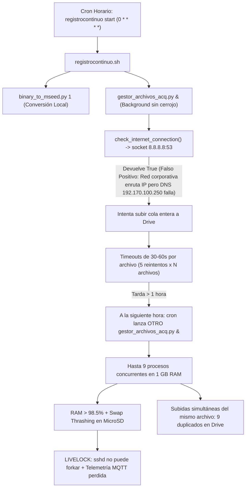

# Plan de Implementación: Blindaje y Corrección de Scripts contra Saturación de Memoria, Concurrencia y Bloqueo de Acceso Remoto

**Fecha**: 2026-10-14  
**Proyecto**: `acelerografo-DEV00` (`RSA-Acelerografo`)  
**Objetivo**: Corregir de raíz los fallos de arquitectura en los scripts del ciclo horario (`scripts/task/registrocontinuo.sh`, `scripts/operation/drive/gestor_archivos_acq.py` y `scripts/operation/drive/subir_archivo.py`) que provocaron saturación del 98.5%+ de RAM, swap thrashing, duplicación masiva en Google Drive y pérdida de conectividad SSH en las estaciones acelerográficas `CHA02` y `CHA01`. Se reutilizan e integran los patrones y mecanismos probados con éxito en `procesar_y_subir_pendientes.py`.

---

## 1. Diagnóstico y Causa Raíz

En incidentes pasados (documentados en `docs/analysis/2026-09-30_diagnostico_saturacion_memoria_y_bloqueo_subidas_drive.md`), se evidenció una cadena de fallos:



### Mecanismos Clave de `procesar_y_subir_pendientes.py` Reutilizados
1. **Cerrojo atómico exclusivo de proceso (`fcntl.flock`)**:
   - Impide de forma absoluta la ejecución simultánea de múltiples instancias. Si una está activa, la nueva sale limpiamente con código `0` y aviso en logs.
2. **Validación real de resolución DNS con *Fail-Fast***:
   - `socket.getaddrinfo("www.googleapis.com", 443, timeout=5)`.
   - Si no resuelve el dominio, aborta de inmediato la subida sin consumir reintentos ni iterar archivos.
   - Si durante el lote ocurre una desconexión o fallo repetido, aborta el lote restante.
3. **Dosificación por lotes (`batch_size`) y espaciado anti-*bufferbloat***:
   - Solo sube un lote configurable (20 archivos por corrida horaria), evitando colas infinitas.
   - Pausa de 1.5s entre transferencias (`time.sleep(1.5)`) para proteger el canal celular/satelital y la telemetría MQTT.
4. **Recolección periódica de basura (`gc.collect()`)**:
   - Libera buffers de red y descriptores en memoria tras cada subida o evaluación de retención.
5. **Prioridad estricta de subidas (Eventos primero, Continuos después)**:
   - Sube primero sismos disparados (críticos, ~100 KB) y luego miniSEED continuos (~2.5 MB).

---

## 2. Modificaciones Implementadas

### Fase 1: Guarda de Concurrencia en `registrocontinuo.sh`
- Se incorporó la función `is_running "gestor_archivos_acq.py"` antes del despacho en segundo plano.
- Si existe un proceso en ejecución, emite una advertencia limpia y omite el lanzamiento concurrente.

### Fase 2: Blindaje de `gestor_archivos_acq.py`
- Adquisición de cerrojo `/tmp/gestor_archivos_acq.lock` al iniciar `main()`, con liberación garantizada en bloque `finally:` junto a `gc.collect()`.
- Sustitución de `check_internet_connection()` por consulta `socket.getaddrinfo("www.googleapis.com", 443, timeout=5)`.
- Reordenamiento de la cola de subida: Eventos (P1), miniSEED (P2), binarios .dat (P3).
- Límite de lote configurable con `batch_size: 20`.
- Pausa de 1.5s entre subidas exitosas y mecanismo *fail-fast* si la conexión falla a mitad del lote.
- Función `obtener_archivos_activos_continuous()` para blindar los archivos en grabación SPI contra purgas de espacio o retención.

### Fase 3: Timeout Seguro en `subir_archivo.py`
- Reducción del timeout de `Http` de 300 segundos a 60 segundos.

### Fase 4: Parámetro en `configuracion_dispositivo.json.template`
- Inclusión de `"batch_size": 20` dentro de `"drive.config"`.

### Fase 5: Suite de Pruebas Unitarias Automatizadas
- Creación de `scripts/operation/drive/test_gestor_archivos_acq.py` cubriendo resolución DNS real, exclusión mutua por cerrojo, detección de archivos activos y comportamiento ante cerrojo ocupado en `main()`.

---

## 3. Plan de Verificación

### Pruebas Unitarias Automatizadas
```bash
cd /home/rsa/projects/acelerografo/scripts/drive
$PROJECT_LOCAL_ROOT/.venv/bin/python3 test_gestor_archivos_acq.py
```
O desde el repositorio de desarrollo:
```bash
cd montajes/acelerografo-DEV00/scripts/operation/drive
python3 -m unittest test_gestor_archivos_acq.py -v
```

### Comprobación de Regresión
```bash
python3 -m unittest test_procesar_y_subir_pendientes.py -v
```
