# Plan de Implementación: Arquitectura de Ingesta Unidireccional Egress-Only por HTTPS hacia VPS Central (Reemplazo Seguro de Google Drive)

**Fecha**: 2026-10-20  
**Proyecto**: `acelerografo-DEV00` (`RSA-Acelerografo`)  
**Documentos de Diagnóstico y Contexto Base**:
- [`docs/analysis/2026-10-19_diagnostico_acumulacion_archivos_y_fallo_control_espacio_drive.md`](file:///C:/Users/miltonrsa/Documents/git/rsa/RSA-Acelerografo/docs/analysis/2026-10-19_diagnostico_acumulacion_archivos_y_fallo_control_espacio_drive.md)
- [`docs/analysis/2026-09-30_diagnostico_saturacion_memoria_y_bloqueo_subidas_drive.md`](file:///C:/Users/miltonrsa/Documents/git/rsa/RSA-Acelerografo/docs/analysis/2026-09-30_diagnostico_saturacion_memoria_y_bloqueo_subidas_drive.md)
- [`docs/adr/024_blindaje_pipeline_drive_livelock_memoria_concurrencia.md`](file:///C:/Users/miltonrsa/Documents/git/rsa/RSA-Acelerografo/docs/adr/024_blindaje_pipeline_drive_livelock_memoria_concurrencia.md)
- [`docs/adr/025_robustecimiento_cerrojos_y_control_espacio_disco.md`](file:///C:/Users/miltonrsa/Documents/git/rsa/RSA-Acelerografo/docs/adr/025_robustecimiento_cerrojos_y_control_espacio_disco.md)

**Objetivo**:  
Diseñar, implementar y certificar una arquitectura de transmisión de datos sismológicos (MiniSEED horarios y eventos GPD) basada en **ingesta unidireccional por HTTPS (Egress-only, puerto TCP 443)** hacia el VPS institucional de la RSA en DigitalOcean (1 vCPU, 1 GB RAM, 25 GB SSD). 

Esta solución reemplaza la dependencia frágil y no profesional de las APIs comerciales de Google Drive, la cual colapsa en estaciones de campo (`CHA01`, `CHA02`) debido a los mecanismos de protección perimetral corporativos (Data Loss Prevention, rate-limiting e intoxicación/bloqueo de DNS hacia dominios `*.googleapis.com`). La arquitectura garantiza **cero objeciones de seguridad por parte de administradores de TI en infraestructuras críticas** (sin puertos de escucha entrantes, sin túneles de red ni interfaces VPN virtuales), integridad sismológica por checksum SHA-256, autenticación por Bearer Token por estación, y una gestión estricta de almacenamiento en el VPS mediante un buffer rotativo con reenvío desatendido (*offload*).

---

## Prerrequisitos y Restricciones Operativas

1. **Infraestructura del VPS Existente**:
   - Proveedor: DigitalOcean Droplet Básico ($6/mes).
   - Especificaciones: 1 vCPU, 1 GB RAM, 25 GB SSD, IP pública fija dedicada.
   - Acceso: Privilegios de superusuario (`root`) vía SSH y consola web.
   - Carga actual: Broker MQTT Mosquitto activo (consumo < 15 MB RAM, < 1% CPU).
   - Recursos disponibles para ingesta: ~900 MB RAM libres y ~20 GB de disco utilizables para buffer.
2. **Restricción de Seguridad Perimetral Institucional (Infraestructuras Críticas)**:
   - Las redes de `CHA01`, `CHA02` y campus universitarios bloquean VPNs de malla (Tailscale, ZeroTier) y túneles L3 (WireGuard/OpenVPN) por ser catalogados como *Shadow IT* o puertas traseras potenciales.
   - Solo se permite tráfico saliente **Egress-only** hacia destinos fijos en lista blanca sobre puertos estándar (TCP 443 HTTPS y TCP 8883 MQTTS).
   - Inbound en la estación: **DROP total** (cero puertos escuchando hacia la red).
3. **Restricciones del Acelerógrafo en Campo**:
   - Arquitectura ARM (Raspberry Pi OS Debian Bullseye / Bookworm).
   - El pipeline de adquisición SPI (`registro_continuo_4.5.0.c`) no debe sufrir pausas ni interferencias de I/O.
   - Mantenimiento estricto de las protecciones de cerrojo `flock`, retención temporal y cuotas de disco alcanzadas en el ADR-024 y ADR-025.

---

## Diagrama de Arquitectura de la Solución

```mermaid
flowchart LR
    subgraph Campo ["Estación Acelerográfica (CHA01 / CHA02)"]
        direction TB
        SPI["Adquisición SPI (dsPIC33)"] --> MSEED["Generador MiniSEED Horario + Eventos GPD"]
        MSEED --> GESTOR["gestor_archivos_acq.py"]
        GESTOR --> CLIENTE["transmisor_https.py (Egress Client)"]
    end

    subgraph RedCorp ["Red Institucional / Firewall"]
        direction TB
        FW["Next-Gen Firewall (NGFW)<br/>• Regla Saliente: TCP 443 whitelist<br/>• Inbound: BLOQUEADO (DROP)<br/>• Cero túneles L3"]
    end

    subgraph VPS ["VPS DigitalOcean ($6/mes - IP Fija)"]
        direction TB
        CADDY["Caddy Server (TLS 1.3 / Let's Encrypt)<br/>Puerto TCP 443"]
        API["Microservicio Ingesta (FastAPI/Uvicorn)<br/>Valida Bearer Token + SHA-256"]
        BUFFER["Buffer Local Rotativo (/var/rsa/inbox/)<br/>Capacidad máxima: 5 GB"]
        RCLONE["Servicio Offload (rclone timer)<br/>Copia desatendida a Almacenamiento Final"]
        
        CADDY -->|Reverse Proxy :8000| API
        API --> BUFFER
        BUFFER --> RCLONE
    end

    subgraph StorageFinal ["Almacenamiento Central Institucional"]
        GDRIVE["Google Drive RSA / NAS Central<br/>(Respaldado desde el VPS sin bloqueos DNS)"]
    end

    CLIENTE -->|POST HTTPS /api/v1/subir| FW
    FW -->|Tráfico 443 saliente| CADDY
    RCLONE -.->|Sincronización segura fuera de red corp| GDRIVE
```



---

## Fase 1: Especificación del Contrato de API de Ingesta y Seguridad

**Objetivo**: Establecer un contrato REST HTTP estricto, idempotente y ligero para la recepción de archivos sismológicos, con validación criptográfica y autenticación de un solo sentido.

### 1. Endpoint y Método
- **URL**: `POST https://<DOMINIO_O_IP_VPS>/api/v1/subir`
- **Content-Type**: `multipart/form-data`

### 2. Encabezados HTTP (Headers) Requeridos

| Encabezado | Tipo | Descripción | Ejemplo |
|---|---|---|---|
| `Authorization` | String | Esquema Bearer con token secreto unívoco por estación | `Bearer rsa_sec_cha01_9f83a...` |
| `X-Station-Id` | String | Identificador alfanumérico estandarizado de la estación | `CHA01`, `DEV00` |
| `X-File-Type` | String | Categoría sismológica del archivo (`mseed`, `event`, `continuous`) | `mseed` |
| `X-File-Name` | String | Nombre base del archivo original | `CHA1_20261020_110000.mseed` |
| `X-File-SHA256` | String | Hash hexadecimal SHA-256 de 64 caracteres calculado antes de enviar | `e3b0c44298fc1c149afbf4...` |
| `X-Timestamp-UTC`| String | Marca temporal ISO 8601 de emisión | `2026-10-20T11:00:02Z` |

### 3. Payload (Body)
- Campo `file`: Contenido binario del archivo sismológico.

### 4. Matriz de Códigos de Respuesta HTTP

| Código | Estado | Significado Técnico | Acción en la Estación |
|---|---|---|---|
| `200 OK` | `success` | Archivo recibido íntegramente, SHA-256 verificado y persistido en buffer | Registrar en `uploaded_files_registry.json` como éxito. |
| `400 Bad Request` | `checksum_mismatch` | El SHA-256 calculado por el VPS difiere del encabezado | Reintentar subida (posible corrupción en tránsito). |
| `401 Unauthorized` | `invalid_token` | Token ausente, revocado o no correspondiente al `Station-Id` | Abortar lote y alertar por log estructurado. |
| `409 Conflict` | `already_exists` | El archivo ya existe en el VPS con idéntico SHA-256 | Tratado como éxito (idempotencia). Registrar como subido. |
| `413 Payload Too Large`| `file_too_large` | El archivo supera el tamaño máximo permitido (límite 50 MB) | Registrar error y marcar en registro para revisión. |
| `507 Insufficient Storage` | `storage_full` | El buffer del VPS superó su margen de seguridad (disco > 85%) | Salida limpia con reintento en el próximo ciclo horario. |

### 5. Esquema JSON de Respuesta Exitosa (`200 OK`)
```json
{
  "status": "success",
  "station_id": "CHA01",
  "file_name": "CHA1_20261020_110000.mseed",
  "file_type": "mseed",
  "bytes_received": 4210560,
  "sha256": "e3b0c44298fc1c149afbf4c8996fb92427ae41e4649b934ca495991b7852b855",
  "stored_path": "CHA01/mseed/2026/10/CHA1_20261020_110000.mseed",
  "server_time_utc": "2026-10-20T11:00:03.124Z"
}
```

### Comprobación (Checkpoint 1)
- Validación de especificación mediante esquema JSON OpenAPI 3.0 exportable.

---

## Fase 2: Implementación y Configuración del Receptor en el VPS

**Objetivo**: Desplegar en el Droplet de DigitalOcean un microservicio de ingesta de ultra-bajo consumo (< 40 MB RAM) con terminación TLS automática y aislamiento de procesos.

### 1. Pila Tecnológica en el VPS
- **Servidor Web / Reverse Proxy**: **Caddy v2** (binario nativo en Go, TLS 1.3 automático vía Let's Encrypt o ZeroSSL, gestión de certificados sin mantenimiento).
- **Backend de Ingesta**: **FastAPI** + **Uvicorn** (asíncrono, validación rápida de streams y headers).
- **Gestor de Procesos**: `systemd` gestionando `rsa-ingest.service`.

### 2. Estructura de Directorios en el VPS
```text
/opt/rsa-ingest/
├── .venv/                      # Entorno virtual Python 3 (FastAPI, uvicorn, python-multipart)
├── app/
│   ├── main.py                 # Endpoint POST /api/v1/subir con verificación SHA-256
│   ├── auth.py                 # Verificación de tokens de estación
│   └── config.py               # Umbrales de disco y rutas de buffer
├── config/
│   └── stations_tokens.json    # Tokens autorizados por estación (permisos 0600 root:root)
/var/rsa/inbox/                 # Directorio de buffer local de almacenamiento
├── CHA01/
│   ├── mseed/
│   └── event/
├── CHA02/
└── DEV00/
```

### 3. Implementación del Servicio en el VPS (`/opt/rsa-ingest/app/main.py`)
```python
import os
import hashlib
import json
import shutil
from fastapi import FastAPI, Header, HTTPException, UploadFile, File, status
from fastapi.responses import JSONResponse

app = FastAPI(title="RSA Seismic Ingest API", version="1.0.0")

BUFFER_ROOT = "/var/rsa/inbox"
TOKENS_PATH = "/opt/rsa-ingest/config/stations_tokens.json"
MAX_DISK_USAGE_PERCENT = 85.0

def verificar_token(station_id: str, auth_header: str) -> bool:
    if not auth_header or not auth_header.startswith("Bearer "):
        return False
    token = auth_header.split(" ")[1]
    try:
        with open(TOKENS_PATH, "r") as f:
            tokens_db = json.load(f)
        return tokens_db.get(station_id) == token
    except Exception:
        return False

@app.post("/api/v1/subir")
async def recibir_archivo(
    authorization: str = Header(None),
    x_station_id: str = Header(None),
    x_file_type: str = Header(None),
    x_file_name: str = Header(None),
    x_file_sha256: str = Header(None),
    file: UploadFile = File(...)
):
    # 1. Autenticación de estación
    if not x_station_id or not verificar_token(x_station_id, authorization):
        raise HTTPException(status_code=status.HTTP_401_UNAUTHORIZED, detail="Token no autorizado")

    # 2. Control de espacio preventivo en buffer
    total, used, free = shutil.disk_usage(BUFFER_ROOT)
    percent_used = (used / total) * 100.0
    if percent_used > MAX_DISK_USAGE_PERCENT:
        raise HTTPException(status_code=status.HTTP_507_INSUFFICIENT_STORAGE, detail="Buffer lleno")

    # 3. Preparación de ruta destino
    dest_dir = os.path.join(BUFFER_ROOT, x_station_id, x_file_type or "general")
    os.makedirs(dest_dir, exist_ok=True)
    safe_name = os.path.basename(x_file_name or file.filename)
    dest_path = os.path.join(dest_dir, safe_name)

    # 4. Recepción en streaming y cálculo de SHA-256 al vuelo
    sha256_hash = hashlib.sha256()
    bytes_count = 0
    temp_path = dest_path + ".uploading"

    try:
        with open(temp_path, "wb") as buffer:
            while chunk := await file.read(65536):
                buffer.write(chunk)
                sha256_hash.update(chunk)
                bytes_count += len(chunk)
    except Exception as e:
        if os.path.exists(temp_path):
            os.remove(temp_path)
        raise HTTPException(status_code=500, detail=f"Error escribiendo archivo: {str(e)}")

    calculado_sha256 = sha256_hash.hexdigest().lower()

    # 5. Validación de integridad estricta
    if x_file_sha256 and calculado_sha256 != x_file_sha256.lower():
        os.remove(temp_path)
        raise HTTPException(
            status_code=status.HTTP_400_BAD_REQUEST,
            detail=f"Checksum no coincide. Esperado: {x_file_sha256}, Calculado: {calculado_sha256}"
        )

    # Reemplazo atómico al destino final
    os.replace(temp_path, dest_path)

    return JSONResponse(
        status_code=status.HTTP_200_OK,
        content={
            "status": "success",
            "station_id": x_station_id,
            "file_name": safe_name,
            "bytes_received": bytes_count,
            "sha256": calculado_sha256
        }
    )
```

### 4. Configuración de Caddy (`/etc/caddy/Caddyfile`)
```caddy
datos.rsa.ec {
    encode gzip zstd
    
    # Límite de tamaño máximo por archivo (50MB)
    request_body {
        max_size 50MB
    }

    # Proxy inverso al backend local FastAPI
    reverse_proxy 127.0.0.1:8000 {
        header_up X-Real-IP {remote_host}
    }

    log {
        output file /var/log/caddy/rsa_ingest.log {
            roll_size 10mb
            roll_keep 5
        }
    }
}
```

### Comprobación (Checkpoint 2)
- Ejecución de prueba de subida sintética con `curl`:
  ```bash
  sha256=$(sha256sum test_file.mseed | awk '{print $1}')
  curl -i -X POST https://datos.rsa.ec/api/v1/subir \
    -H "Authorization: Bearer <TOKEN_DEV00>" \
    -H "X-Station-Id: DEV00" \
    -H "X-File-Type: mseed" \
    -H "X-File-Name: test_file.mseed" \
    -H "X-File-SHA256: $sha256" \
    -F "file=@test_file.mseed"
  # Respuesta esperada: HTTP/2 200 con status: success
  ```

---

## Fase 3: Módulo Transmisor HTTPS en la Estación (`transmisor_https.py`)

**Objetivo**: Crear un módulo cliente en Python desacoplado, ultraligero y con cero dependencias externas conflictivas para sustituir funcionalmente a `subir_archivo.py`.

### 1. Archivos Creados / Afectados
- [`scripts/operation/transmission/transmisor_https.py`](file:///C:/Users/miltonrsa/Documents/git/rsa/RSA-Acelerografo/scripts/operation/transmission/transmisor_https.py) (Nuevo)
- [`scripts/operation/transmission/test_transmisor_https.py`](file:///C:/Users/miltonrsa/Documents/git/rsa/RSA-Acelerografo/scripts/operation/transmission/test_transmisor_https.py) (Nuevo)

### 2. Características del Módulo
- **Cero dependencias pesadas**: Construido sobre biblioteca estándar (`urllib.request`, `http.client`, `hashlib`) o `requests` si ya está presente en el venv, evitando el gigantesco overhead de `google-api-python-client` y `google-auth`.
- **Cálculo previo de SHA-256**: Genera el hash del archivo en disco antes de abrir la conexión HTTP.
- **Mecanismo de Reintentos con Retroceso Exponencial**: 3 intentos por defecto con espera de 2s, 4s, 8s.
- **Fail-Fast de Red**: Aborta inmediatamente si el host del VPS no es alcanzable o si el servidor devuelve error de autenticación 401.

### 3. Firma e Interfaz del Transmisor
```python
def subir_archivo_https(
    url_servidor: str,
    token_estacion: str,
    id_estacion: str,
    ruta_archivo: str,
    tipo_archivo: str,
    max_reintentos: int = 3,
    tiempo_espera: int = 2,
    logger = None,
    timeout: int = 30
) -> bool:
    """
    Sube un archivo sismológico mediante POST HTTPS autenticado con verificación SHA-256.
    Retorna True si el VPS confirmó recepción (HTTP 200 o HTTP 409).
    Retorna False si falló tras agotar reintentos.
    """
```

### Comprobación (Checkpoint 3)
- Suite unitaria automatizada `test_transmisor_https.py` con 5 pruebas aisladas:
  1. `test_subida_exitosa_200` (con servidor HTTP local de prueba `http.server`).
  2. `test_subida_idempotente_409_devuelve_exito`.
  3. `test_fallo_autenticacion_401_aborta_sin_reintentos_inutiles`.
  4. `test_checksum_invalido_reintenta_correctamente`.
  5. `test_timeout_red_capturado_limpiamente`.

---

## Fase 4: Integración en `gestor_archivos_acq.py` y Plantilla de Configuración

**Objetivo**: Integrar el despacho por HTTPS en el gestor horario, manteniendo retrocompatibilidad mediante selector de backend y reutilizando el registro atómico `uploaded_files_registry.json`.

### 1. Archivos Afectados
- [`configuration/configuracion_dispositivo.json.template`](file:///C:/Users/miltonrsa/Documents/git/rsa/RSA-Acelerografo/configuration/configuracion_dispositivo.json.template)
- [`scripts/operation/drive/gestor_archivos_acq.py`](file:///C:/Users/miltonrsa/Documents/git/rsa/RSA-Acelerografo/scripts/operation/drive/gestor_archivos_acq.py)

### 2. Modificación de la Plantilla de Configuración
Se incorpora el bloque `"transmision"` preservando el bloque `"drive"` para contingencia:
```json
{
    "dispositivo": {
        "id": "{{ESTACION_ID}}",
        "fuente_reloj": "{{FUENTE_RELOJ}}",
        "deteccion_eventos": "{{DETECCION_EVENTOS}}",
        "publicar_eventos": "{{PUBLICAR_EVENTOS}}",
        "modo_adquisicion": "{{MODO_ADQUISICION}}"
    },
    "transmision": {
        "metodo": "https_vps",
        "https_vps": {
            "url": "https://datos.rsa.ec/api/v1/subir",
            "token": "{{STATION_INGEST_TOKEN}}",
            "batch_size": 20,
            "max_reintentos": 3,
            "tiempo_espera": 2,
            "timeout_segundos": 30
        }
    },
    "drive": {
        "carpetas": { ... },
        "config": { ... }
    }
}
```

### 3. Modificaciones en `gestor_archivos_acq.py`
1. **Detección de Método de Transmisión**:
   - Leer `config.get("transmision", {}).get("metodo", "drive")`.
   - Si `metodo == "https_vps"`, derivar la subida a `subir_archivo_https()`.
   - Si `metodo == "drive"`, usar el cliente tradicional Google Drive (preserva compatibilidad con estaciones que no migren de inmediato).
2. **Reutilización del Registro Atómico**:
   - Tras recibir confirmación del transmisor HTTPS, invocar `marcar_como_exitoso(log_directory, nombre_archivo, tipo_archivo)` en `drive_status_manager.py`.
   - No se altera la estructura de `uploaded_files_registry.json`, garantizando que la retención temporal y las políticas de espacio funcionen exactamente igual.

### Comprobación (Checkpoint 4)
- Ejecución con bandera `--dry-run`:
  `python3 gestor_archivos_acq.py --dry-run`
  Debe reportar:
  `[INFO] [INIT] | modo=online | metodo_transmision=https_vps | destino=https://datos.rsa.ec/api/v1/subir`
  `[DRY-RUN] Se subiría vía HTTPS | mseed | CHA1_20261020_110000.mseed`

---

## Fase 5: Mecanismo de Offload Automático y Purga en el VPS

**Objetivo**: Evitar la saturación del disco de 25 GB del VPS mediante un timer desatendido que respalda los archivos sismológicos en almacenamiento final y purga el buffer local.

### 1. Script de Sincronización en el VPS (`/opt/rsa-ingest/scripts/offload_buffer.sh`)
```bash
#!/bin/bash
set -euo pipefail

BUFFER_DIR="/var/rsa/inbox"
LOG_FILE="/var/log/rsa-offload.log"
REMOTE_DEST="gdrive_rsa:RSA-Acelerografos"

# 1. Copia incremental a almacenamiento final (ej. Google Drive institucional montado con rclone)
echo "[$(date -u +'%Y-%m-%d %H:%M:%SZ')] Iniciando sincronización de buffer a destino remoto..." >> "$LOG_FILE"
rclone copy "$BUFFER_DIR" "$REMOTE_DEST" \
    --transfers 4 \
    --checkers 8 \
    --log-file="$LOG_FILE" \
    --log-level INFO

# 2. Purgar del buffer local archivos con más de 72 horas de antigüedad (margen de seguridad)
echo "[$(date -u +'%Y-%m-%d %H:%M:%SZ')] Purgando archivos mayores a 72 horas en buffer..." >> "$LOG_FILE"
find "$BUFFER_DIR" -type f -mmin +4320 -delete

# 3. Eliminar directorios vacíos
find "$BUFFER_DIR" -type d -empty -delete
```

### 2. Temporizador Systemd (`/etc/systemd/system/rsa-offload.timer`)
- Frecuencia: Cada 30 minutos (`OnCalendar=*:0/30`).
- Ejecuta `rsa-offload.service`.

### Comprobación (Checkpoint 5)
- Ejecución manual de `systemctl start rsa-offload.service`.
- Verificación de log en `/var/log/rsa-offload.log` mostrando transferencia exitosa y liberación de inodos.

---

## Fase 6: Dossier y Formato de Solicitud para Administradores de TI

**Objetivo**: Elaborar la documentación formal y concisa lista para ser entregada a los departamentos de TI/Seguridad de las infraestructuras críticas donde operan `CHA01` y `CHA02`.

### Archivo Creado
- [`docs/operations/solicitud_apertura_firewall_ti.md`](file:///C:/Users/miltonrsa/Documents/git/rsa/RSA-Acelerografo/docs/operations/solicitud_apertura_firewall_ti.md)

### Contenido Estructurado de la Solicitud
1. **Descripción del Sistema**: Equipo acelerográfico científico para monitoreo de integridad estructural y sismológica.
2. **Postura de Seguridad Perimetral**:
   - Tráfico Inbound: **BLOQUEADO (DROP)**. No se requiere ni se solicita apertura de puertos hacia la estación.
   - Tráfico Outbound (Saliente): **Únicamente 2 flujos específicos hacia IP fija institucional**:
     * Destino: IP del VPS de la RSA (`159.203.X.X` / `datos.rsa.ec`).
     * Puerto 1: `TCP 443 (HTTPS)` - Ingesta de archivos de datos sismológicos vía API REST cifrada.
     * Puerto 2: `TCP 8883 (MQTTS)` - Telemetría de estado y salud física del sensor.
3. **Justificación Anti-Riesgo**:
   - Sin túneles VPN ni proxies de red (sin interfaces virtuales L2/L3).
   - Inmune a pivoteo de red: comunicación unidireccional por aplicación (Capa 7).
   - Sin acceso a redes de almacenamiento de archivos públicas ni de uso personal (cero alertas DLP).

---

## Fase 7: Validación de Extremo a Extremo y Plan de Rollout

**Objetivo**: Certificar la solución en entorno de desarrollo (`DEV00`) y desplegar ordenadamente en `CHA01` y `CHA02`.

### Cronograma de Rollout

| Paso | Entorno | Acción | Criterio de Aceptación |
|---|---|---|---|
| **P-1** | VPS | Configuración de Caddy, FastAPI y tokens en DigitalOcean | `curl` local y remoto devuelve 200 OK y almacena archivo en `/var/rsa/inbox/`. |
| **P-2** | `DEV00` | Pruebas unitarias de `transmisor_https.py` y modo `--dry-run` | 100% pruebas OK; dry-run simula transmisión HTTPS nominal. |
| **P-3** | `DEV00` | Conmutación real a `metodo: "https_vps"` durante 24 horas | 24 archivos `.mseed` transmitidos al VPS; registros en `uploaded_files_registry.json` intactos; cero degradación en adquisición SPI. |
| **P-4** | TI | Envío de solicitud formal de regla Egress para `CHA01` y `CHA02` | Regla aprobada en firewall institucional. |
| **P-5** | `CHA01` | Despliegue piloto con configuración actualizada y token dedicado | Estación evacúa backlog acumulado sin presentar bloqueos de DNS ni saturación de RAM. |
| **P-6** | `CHA02` | Despliegue definitivo en segunda estación crítica | Reactivación completa y autónoma de la red de acelerógrafos de la RSA. |

---

## Auto-Revisión del Plan (Checklist de Calidad)

- [x] **¿Se leyó el código fuente de los archivos involucrados?** Sí: `gestor_archivos_acq.py`, `subir_archivo.py`, `configuracion_dispositivo.json.template` y ADRs previos.
- [x] **¿Los esquemas y contratos están definidos explícitamente?** Sí: se especificó la cabecera HTTP completa, códigos de estado, payload y esquema JSON de respuesta.
- [x] **¿Se respetan las restricciones de recursos?** Sí: el VPS de 1 GB RAM corre Caddy + FastAPI (< 50 MB RAM combinados) y buffer rotativo con offload para no saturar los 25 GB SSD.
- [x] **¿La solución atiende la objeción de seguridad de TI?** Sí: se descarta por completo la VPN de túnel inverso L3 (Shadow IT) y se opta por Egress-only HTTPS en el puerto estándar 443 hacia una IP fija whitelistable.
- [x] **¿Se preserva la compatibilidad con el sistema actual?** Sí: `uploaded_files_registry.json`, las políticas de retención temporal y el control de espacio en disco (ADR-024 y ADR-025) continúan gobernando el ciclo de vida local.
