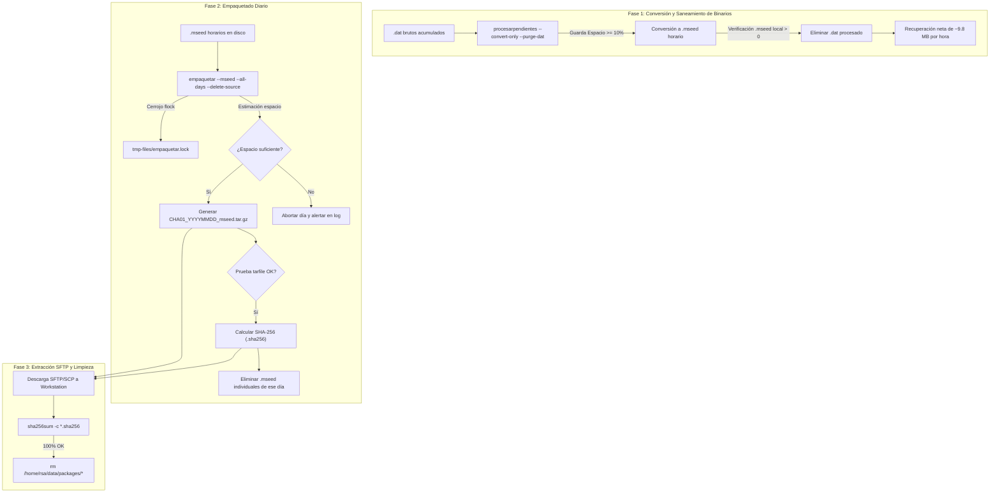

# Plan de Implementación: Contingencia de Conversión Offline, Empaquetado Diario y Exportación SFTP para Estaciones Acelerográficas

**Fecha**: 2026-10-21  
**Proyecto**: `acelerografo-DEV00` (`RSA-Acelerografo`)  
**Rama de Trabajo**: `feature/contingencia-extraccion-sftp`  
**Documentos de Diagnóstico y Contexto Base**:
- [`docs/analysis/2026-10-19_diagnostico_acumulacion_archivos_y_fallo_control_espacio_drive.md`](file:///home/rsa/git/montajes/acelerografo-DEV00/docs/analysis/2026-10-19_diagnostico_acumulacion_archivos_y_fallo_control_espacio_drive.md)
- [`docs/blueprints/2026-10-20_plan_arquitectura_ingesta_egress_https_vps.md`](file:///home/rsa/git/montajes/acelerografo-DEV00/docs/blueprints/2026-10-20_plan_arquitectura_ingesta_egress_https_vps.md)
- [`docs/adr/024_blindaje_pipeline_drive_livelock_memoria_concurrencia.md`](file:///home/rsa/git/montajes/acelerografo-DEV00/docs/adr/024_blindaje_pipeline_drive_livelock_memoria_concurrencia.md)
- [`docs/adr/025_robustecimiento_cerrojos_y_control_espacio_disco.md`](file:///home/rsa/git/montajes/acelerografo-DEV00/docs/adr/025_robustecimiento_cerrojos_y_control_espacio_disco.md)

**Objetivo**:  
Diseñar, implementar y certificar una solución de contingencia y transporte sismológico para evacuar con seguridad los datos retenidos en las estaciones acelerográficas remotas `CHA01` y `CHA02`, cuyo enlace con Google Drive está bloqueado por el DNS institucional de la red corporativa.

La solución se estructura en dos herramientas modulares y coordinadas:
1. **Refactorización y blindaje de `procesar_y_subir_pendientes.py`**: Unificación de flags a inglés estándar (`--convert-only`, `--upload-only`), desacople de la comprobación DNS para que la conversión local opere de forma autónoma sin red, modificación de `--purge-dat` para que elimine binarios brutos basándose en la existencia local verificada del MiniSEED (liberando netamente ~9.8 MB por hora procesada), e incorporación de una guarda preventiva de espacio libre en disco (< 10%).
2. **Nuevo script dedicado de empaquetado y exportación `empaquetar_archivos.py`** (wrapper `/usr/local/bin/empaquetar`): Herramienta modular para comprimir archivos por tipo único (`--mseed`, `--continuous`, `--events`, `--logs`) organizados por día (`--date`, `--start-date`/`--end-date`, `--all-days`) hacia `/home/rsa/data/packages/`, con verificación de integridad previa a la purga (`--delete-source`), prohibición estricta de borrado en logs, sumas de verificación SHA-256 estándar GNU, estimación previa de espacio en disco, logs dedicados y cerrojo atómico `flock` apto para ejecuciones desatendidas en `crontab` en estaciones offline.
3. **Documentación interactiva y pruebas**: Incorporación de ayuda en `scripts/task/ayuda.sh` y certificación de pruebas unitarias automatizadas.

---

## Prerrequisitos y Restricciones Operativas

1. **Restricción SSHFS Activa**: La estación de desarrollo `DEV00` está montada bajo `montajes/acelerografo-DEV00`. Ningún comando autónomo puede ejecutarse en el equipo remoto. Todo comando de sistema o servicio debe proporcionarse al usuario formateado para copy-paste.
2. **Almacenamiento Crítico en MicroSD (16 GB)**:
   - Capacidad útil total de `/dev/root`: ~14.5 GB.
   - En situaciones de contingencia, el espacio libre puede encontrarse en zonas de alarma (< 10% / < 1.5 GB).
   - El proceso de empaquetado no debe generar colapso de almacenamiento temporal durante la compresión.
3. **Aislamiento del Pipeline de Adquisición SPI**:
   - `registro_continuo_4.5.0.c` y el servicio `rsa-acelerografo.service` no deben ser interrumpidos.
   - Todo archivo reportado en `NombreArchivoRegistroContinuo.tmp` o con `mtime < 2h` está estrictamente protegido contra compresión con purga o eliminación.
4. **Entorno de Ejecución**:
   - Python 3.9+ en Raspberry Pi OS ARM.
   - Dependencias estándar sin librerías pesadas: `tarfile`, `hashlib`, `shutil`, `fcntl`, `glob`, `re`, `argparse`.

---

## Diagrama de Flujo del Procedimiento de Contingencia



---

## Fase 1: Refactorización y Blindaje de `procesar_y_subir_pendientes.py`

**Objetivo**: Unificar los flags a inglés estándar, desacoplar la Fase 1 (conversión) de la verificación de red, permitir que `--purge-dat` verifique la existencia local del MiniSEED, e incorporar la guarda de espacio libre mínimo en disco.

### Archivos Afectados
- [`scripts/operation/drive/procesar_y_subir_pendientes.py`](file:///home/rsa/git/montajes/acelerografo-DEV00/scripts/operation/drive/procesar_y_subir_pendientes.py)
- [`scripts/operation/drive/test_procesar_y_subir_pendientes.py`](file:///home/rsa/git/montajes/acelerografo-DEV00/scripts/operation/drive/test_procesar_y_subir_pendientes.py)

### Acciones Detalladas

1. **Unificación de Flags a Inglés Estándar**:
   - Reemplazar `--solo-convertir` por `--convert-only` (manteniendo `--solo-convertir` como alias oculto/retrocompatible con advertencia en consola).
   - Reemplazar `--solo-subir` por `--upload-only` (con alias retrocompatible).
   - Mantener el resto de flags ya en inglés: `--batch-size`, `--all`, `--delete-uploaded`, `--purge-dat`, `--dry-run`, `--verbosity`.

2. **Desacople de la Comprobación DNS**:
   - Mover la lógica de `verificar_dns_drive()` (actualmente en líneas 621–639) para que **no se ejecute antes de la Fase 1**.
   - La comprobación DNS se ejecutará única y exclusivamente al inicio de la **Fase 2 (Subida a Drive)** cuando `not args.convert_only`.
   - Si no hay resolución DNS, la Fase 1 (conversión) concluye al 100% y la Fase 2 emite el aviso informativo y omite la subida sin abortar el proceso previo.

3. **Independencia de Drive en la Purga de Binarios (`--purge-dat`)**:
   - Modificar `purgar_binarios_respaldados()` para que no consulte `ya_fue_subido(..., "mseed")` en `uploaded_files_registry.json`.
   - Criterio de purga directo en filesystem:
     ```python
     mseed_filename = nombrar_archivo_mseed(codigo_estacion, tiempo_binario)
     mseed_path = os.path.join(path_archivos_mseed, mseed_filename)
     
     if os.path.isfile(mseed_path) and os.path.getsize(mseed_path) > 0:
         if binary_filename not in archivos_activos:
             os.remove(binary_file)
     ```
   - Cada `.dat` de ~14 MB se purga al existir su `.mseed` de ~4.2 MB, produciendo una ganancia neta de almacenamiento.

4. **Guarda de Espacio Libre en Disco en la Conversión**:
   - Definir función `verificar_espacio_libre(directorio, umbral_minimo_pct=10.0, min_mb_libres=500)`:
     ```python
     total, used, free = shutil.disk_usage(directorio)
     free_pct = (free / total) * 100.0
     free_mb = free / (1024 * 1024)
     return free_pct >= umbral_minimo_pct and free_mb >= min_mb_libres, free_pct, free_mb
     ```
   - Antes de iniciar la conversión de cada archivo en `convertir_archivos_pendientes()`:
     - Si el espacio libre es inferior a 10.0% (o < 500 MB) y NO está activa la purga inmediata con `--purge-dat`, abortar la conversión emitiendo:
       `[ERROR ESPACIO] Espacio en disco insuficiente: {free_pct:.2f}% ({free_mb:.1f} MB libres). Abortando conversión para proteger adquisición SPI.`
     - Si `--purge-dat` está activo, permitir operar hasta un umbral crítico de 5.0% (dado que la operación total libera espacio).

### Comprobación (Checkpoint 1)
- Ejecutar la suite unitaria:
  ```bash
  python3 scripts/operation/drive/test_procesar_y_subir_pendientes.py
  ```
  Debe superar todas las pruebas existentes más los nuevos casos de purga desacoplada de Drive y verificación de espacio.

---

## Fase 2: Implementación del Módulo de Empaquetado (`empaquetar_archivos.py`)

**Objetivo**: Crear una herramienta dedicada, robusta y segura para compactar archivos sismológicos por fechas y por tipo único, orientada a la extracción por SFTP y optimización de espacio en estaciones offline.

### Archivos Creados
- [`scripts/operation/export/empaquetar_archivos.py`](file:///home/rsa/git/montajes/acelerografo-DEV00/scripts/operation/export/empaquetar_archivos.py)
- [`scripts/operation/export/test_empaquetar_archivos.py`](file:///home/rsa/git/montajes/acelerografo-DEV00/scripts/operation/export/test_empaquetar_archivos.py)

### Especificación de la CLI

```text
empaquetar [-h] [--mseed | --continuous | --events | --logs]
           [--date YYYY-MM-DD] [--start-date YYYY-MM-DD] [--end-date YYYY-MM-DD] [--all-days]
           [--output-dir RUTA] [--delete-source] [--include-today] [--force]
           [--verbose] [--dry-run]
```

### Tabla de Parámetros

| Parámetro | Tipo | Default | Descripción |
|---|---|---|---|
| `--mseed` | Mutex Tipo | **Default** | Origen: `/home/rsa/data/mseed/` |
| `--continuous` | Mutex Tipo | Opcional | Origen: `/home/rsa/data/registro-continuo/` |
| `--events` | Mutex Tipo | Opcional | Origen: `/home/rsa/data/eventos-extraidos/` |
| `--logs` | Mutex Tipo | Opcional | Origen: `$PROJECT_LOCAL_ROOT/log-files/` |
| `--date` | Fecha | `None` | Procesa exactamente el día indicado (`YYYY-MM-DD` o `YYYYMMDD`) |
| `--start-date` | Fecha | `None` | Inicio de rango de días |
| `--end-date` | Fecha | `None` | Fin de rango de días |
| `--all-days` | Booleano | `False` | Escanea el directorio y empaqueta todos los días detectados |
| `--output-dir` | Ruta | `/home/rsa/data/packages/` | Directorio de destino para los `.tar.gz` y `.sha256` |
| `--delete-source` | Booleano | `False` | Elimina archivos originales tras verificar integridad del `.tar.gz` |
| `--include-today` | Booleano | `False` | Permite empaquetar el día en curso en `--all-days` |
| `--force` | Booleano | `False` | Sobrescribe paquetes existentes |
| `--verbose` | Booleano | `False` | Muestra lista detallada de archivos incluidos |
| `--dry-run` | Booleano | `False` | Simulación diagnóstica sin escrituras ni eliminaciones |

### Reglas Críticas de Arquitectura y Seguridad

1. **Exclusión Mutua de Tipo**:
   - `argparse.add_mutually_exclusive_group()` garantiza que solo se seleccione un tipo por corrida (`--mseed`, `--continuous`, `--events` o `--logs`).
2. **Prohibición Estricta de `--delete-source` en `--logs`**:
   - Si se detecta `--logs` junto a `--delete-source`:
     `sys.exit("Error de seguridad: --delete-source está terminantemente prohibido con --logs para proteger los daemons activos.")`
3. **Cerrojo Atómico `flock`**:
   - Ruta del candado: `$PROJECT_LOCAL_ROOT/tmp-files/empaquetar.lock` (fallback `/tmp/empaquetar_${USER}.lock`).
   - Salida limpia con código 0 y log informativo ante colisión concurrente.
4. **Estimación de Espacio y Verificación de Integridad**:
   - Antes de comprimir: verificar que `free_space >= (tamano_archivos * 0.6) + 500 MB`.
   - Escribir primero a `<paquete>.tar.gz.tmp`.
   - Abrir `<paquete>.tar.gz.tmp` con `tarfile.open("r:gz")` y validar lectura de miembros y checksum interno.
   - Renombrar atómicamente a `<paquete>.tar.gz`.
   - Generar `<paquete>.tar.gz.sha256` con formato GNU:
     `<hash_sha256>  <nombre_archivo.tar.gz>\n`
   - Solo tras completar con éxito estos pasos, si `--delete-source` está activo, eliminar los archivos fuente individuales.
5. **Protección del Binario Continuo Activo**:
   - Al usar `--continuous`, invocar `obtener_archivos_activos()` para excluir el archivo activo en grabación SPI.
6. **Logging Dedicado**:
   - Salida en consola y registro estructurado en `$PROJECT_LOCAL_ROOT/log-files/empaquetar.log`.

### Comprobación (Checkpoint 2)
- Ejecutar la suite unitaria `test_empaquetar_archivos.py`:
  ```bash
  python3 scripts/operation/export/test_empaquetar_archivos.py
  ```
  Debe validar:
  1. Empaquetado y SHA-256 de miniSEED por fecha.
  2. Bloqueo de seguridad `--logs --delete-source`.
  3. Exclusión mutua de cerrojos (`flock`).
  4. Omisión del día actual en `--all-days` sin `--include-today`.
  5. Protección de archivos activos continuos.

---

## Fase 3: Wrapper del Sistema y Despliegue

**Objetivo**: Proveer un ejecutable global `/usr/local/bin/empaquetar` y asegurar la creación del directorio `/home/rsa/data/packages` con permisos correctos.

### Archivos Afectados / Creados
- [`scripts/task/empaquetar.sh`](file:///home/rsa/git/montajes/acelerografo-DEV00/scripts/task/empaquetar.sh) (Nuevo)
- [`scripts/setup/deploy.sh`](file:///home/rsa/git/montajes/acelerografo-DEV00/scripts/setup/deploy.sh) (Actualizado para instalar el wrapper)

### Contenido de `empaquetar.sh`
```bash
#!/bin/bash
# Wrapper ejecutable para empaquetado y exportacion de datos sismologicos
# Instalado en /usr/local/bin/empaquetar mediante deploy.sh

if [ -f /usr/local/bin/project_paths ]; then
  source /usr/local/bin/project_paths
elif [ -f "$HOME/projects/acelerografo/scripts/env/project_paths.sh" ]; then
  source "$HOME/projects/acelerografo/scripts/env/project_paths.sh"
fi

PROJECT_LOCAL_ROOT="${PROJECT_LOCAL_ROOT:-$HOME/projects/acelerografo}"
VENV_PYTHON="$PROJECT_LOCAL_ROOT/.venv/bin/python3"
SCRIPT_PYTHON="$PROJECT_LOCAL_ROOT/scripts/export/empaquetar_archivos.py"

if [ ! -f "$VENV_PYTHON" ]; then
  echo "ERROR: Entorno virtual no encontrado en $VENV_PYTHON"
  exit 1
fi

if [ ! -f "$SCRIPT_PYTHON" ]; then
  # Fallback a la ruta del repositorio si se ejecuta antes del deploy
  SCRIPT_PYTHON="$(dirname "$(dirname "$(readlink -f "$0")")")/operation/export/empaquetar_archivos.py"
fi

exec "$VENV_PYTHON" "$SCRIPT_PYTHON" "$@"
```

### Comprobación (Checkpoint 3)
- Verificación de permisos ejecutables (`chmod +x scripts/task/empaquetar.sh`).
- Verificación sintáctica con `bash -n scripts/task/empaquetar.sh`.

---

## Fase 4: Actualización de la Ayuda del Sistema (`ayuda.sh`)

**Objetivo**: Integrar las instrucciones de uso de `procesarpendientes` y `empaquetar` en el menú interactivo de la estación.

### Archivos Afectados
- [`scripts/task/ayuda.sh`](file:///home/rsa/git/montajes/acelerografo-DEV00/scripts/task/ayuda.sh)

### Bloques a Incorporar
```bash
echo "Puesta al Dia y Conversion de Pendientes:"
echo "  Solo convertir binarios:      procesarpendientes --convert-only"
echo "  Convertir y purgar .dat:      procesarpendientes --convert-only --purge-dat --batch-size 48"
echo "  Simular conversion (test):    procesarpendientes --convert-only --dry-run"
echo " "
echo "Empaquetado y Exportacion de Datos (SFTP / Offline):"
echo "  Empaquetar miniSEED del dia:  empaquetar --date YYYY-MM-DD"
echo "  Empaquetar y purgar fuente:   empaquetar --date YYYY-MM-DD --delete-source"
echo "  Empaquetar rango de dias:     empaquetar --start-date YYYY-MM-DD --end-date YYYY-MM-DD"
echo "  Empaquetar todos los dias:    empaquetar --all-days"
echo "  Empaquetar eventos del dia:   empaquetar --events --date YYYY-MM-DD"
echo "  Empaquetar binarios .dat:     empaquetar --continuous --date YYYY-MM-DD"
echo "  Empaquetar snapshot de logs:  empaquetar --logs"
echo "  Simular empaquetado (test):   empaquetar --dry-run"
```

### Comprobación (Checkpoint 4)
- Ejecutar `bash scripts/task/ayuda.sh` y verificar salida formateada en consola.

---

## Fase 5: Procedimiento de Validación y Rollout en Campo (`CHA01` / `CHA02`)

**Objetivo**: Guiar paso a paso al usuario con comandos listos para copy-paste en SSH.

### Flujo de Evacuación en Campo

1. **Paso 1: Drenar y Convertir Binarios Acumulados**
   ```bash
   # En la estacion remota:
   procesarpendientes --convert-only --purge-dat --all
   ```
   *Efecto:* Convierte todos los binarios pendientes a MiniSEED y elimina los `.dat` procesados, ganando ~9.8 MB por hora de datos.

2. **Paso 2: Empaquetar MiniSEED por Días y Purgar Fuentes**
   ```bash
   empaquetar --all-days --delete-source
   ```
   *Efecto:* Genera paquetes diarios `CHA01_YYYYMMDD_mseed.tar.gz` y sus respectivos `.sha256` en `/home/rsa/data/packages/`, comprimiendo a ~60 MB por día y eliminando los 24 archivos sueltos.

3. **Paso 3: Descarga por SFTP / SCP desde Máquina Local**
   ```bash
   # En la workstation local:
   scp rsa@CHA01:/home/rsa/data/packages/* ./respaldos_cha01/
   ```

4. **Paso 4: Verificación Criptográfica y Limpieza en la Estación**
   ```bash
   # En la workstation local:
   cd ./respaldos_cha01/
   sha256sum -c *.sha256
   
   # Tras verificar integridad al 100%, limpiar en la estacion remota:
   ssh rsa@CHA01 "rm -f /home/rsa/data/packages/*"
   ```

5. **Paso 5 (Opcional - Estaciones Offline Permanentes): Automatización en Crontab**
   ```cron
   # Ejecutar todas las noches a las 00:10 UTC empaquetando el dia finalizado
   10 0 * * * /usr/local/bin/empaquetar --all-days --delete-source >> /home/rsa/projects/acelerografo/log-files/empaquetar_cron.log 2>&1
   ```

---

## Auto-Revisión del Plan (Checklist de Calidad)

- [x] **¿Se leyó el código fuente de los archivos involucrados?** Sí: `procesar_y_subir_pendientes.py`, `ayuda.sh`, `binary_to_mseed.py`, `configuracion_dispositivo.json.template` y tests unitarios.
- [x] **¿Los flags y contratos CLI están definidos explícitamente?** Sí, en inglés estándar con tipos, valores por defecto y exclusión mutua.
- [x] **¿Se contemplaron las salvaguardas de espacio y procesos?** Sí: guarda de espacio libre previo al tar, comprobación de integridad con `tarfile` antes del borrado y bloqueo de `--delete-source` con `--logs`.
- [x] **¿Se contempló la concurrencia en cron?** Sí: cerrojo atómico no bloqueante `fcntl.flock` sobre ruta aislada `tmp-files/empaquetar.lock`.
- [x] **¿Las rutas son exactas y los comandos listos para copy-paste?** Sí, alineadas con la arquitectura institucional de la RSA.
