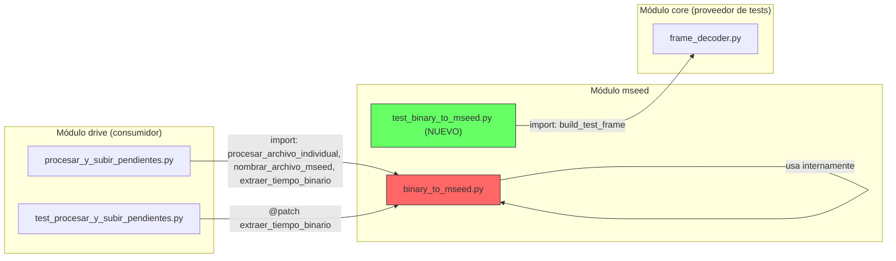
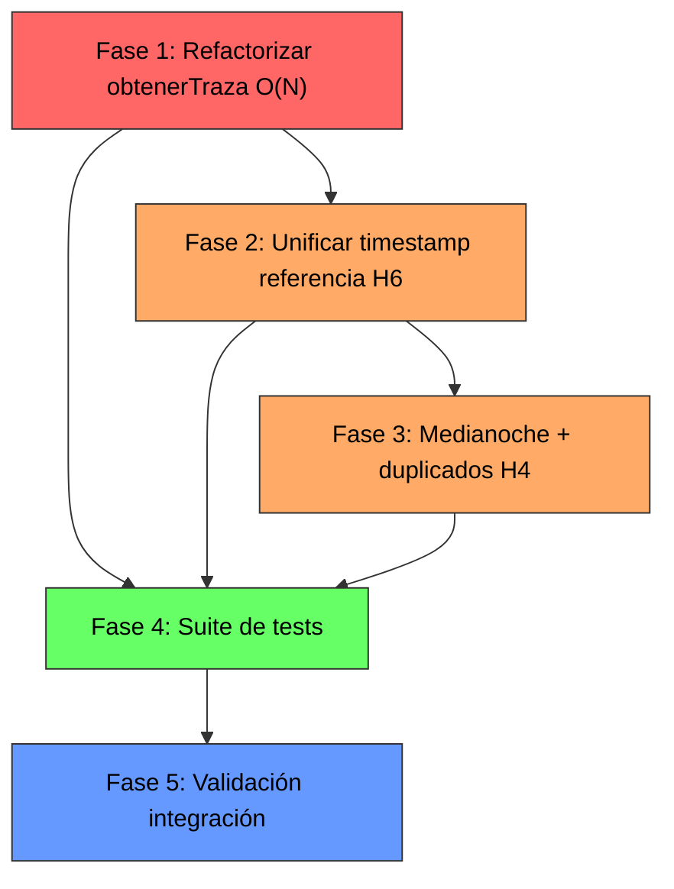

# Plan de Implementación: Refactorización de Conversión Binaria con Gaps en `binary_to_mseed.py`

**Fecha**: 2026-10-23  
**Proyecto**: `RSA-Acelerografo` (`montajes/acelerografo-DEV00`)  
**Diagnóstico base**: [`2026-10-22_diagnostico_bloqueo_cpu_relleno_gaps_binary_to_mseed.md`](file:///home/rsa/git/montajes/acelerografo-DEV00/docs/analysis/2026-10-22_diagnostico_bloqueo_cpu_relleno_gaps_binary_to_mseed.md)  
**Auditoría**: [`auditoria_diagnostico_binary_to_mseed.md`](file:///home/rsa/.gemini/antigravity-ide/brain/13fd8711-793b-46fd-ba74-ba940064af7a/auditoria_diagnostico_binary_to_mseed.md)

**Objetivo**: Eliminar el livelock de CPU $O(M \cdot N)$, la corrupción de fase y la inflación dimensional en la conversión de archivos binarios con gaps temporales, unificar la fuente de timestamp de referencia para erradicar desacoples entre funciones, y crear una suite de pruebas unitarias que certifique la corrección sismológica de la conversión. Todo ello sin romper la interfaz pública del módulo ni las dependencias de `procesar_y_subir_pendientes.py`.

---

## Prerequisitos

| Prerrequisito | Estado | Verificación |
|---|---|---|
| Entorno virtual `.venv` con ObsPy y NumPy | ✅ Disponible | `DEV00:.venv/bin/python3 -c "import obspy; import numpy; print('OK')"` |
| `frame_decoder.py` con `build_test_frame()` | ✅ Disponible | Reutilizable para generar tramas sintéticas en los tests |
| Rama de trabajo Git | ⬜ Pendiente | `git checkout -b fix/refactor-gaps-binary-to-mseed` |
| Ninguna dependencia nueva | ✅ | Solo se usan `numpy`, `obspy`, `unittest` y `os`/`tempfile` (todos ya instalados) |

---

## Mapa de Archivos Afectados y Dependencias



### Superficie de cambio

| Archivo | Acción | Líneas afectadas |
|---|---|---|
| [`binary_to_mseed.py`](file:///home/rsa/git/montajes/acelerografo-DEV00/scripts/operation/mseed/binary_to_mseed.py) | **MODIFICAR** | `leer_archivo_binario` (L99-187), `obtenerTraza` (L404-463), `procesar_archivo_individual` (L478-526) |
| `test_binary_to_mseed.py` | **CREAR** | Nuevo archivo (~250-350 líneas) |
| [`procesar_y_subir_pendientes.py`](file:///home/rsa/git/montajes/acelerografo-DEV00/scripts/operation/drive/procesar_y_subir_pendientes.py) | **NO MODIFICAR** | La interfaz pública se mantiene intacta |

> **Restricción de compatibilidad**: `procesar_y_subir_pendientes.py` importa `procesar_archivo_individual`, `nombrar_archivo_mseed` y `extraer_tiempo_binario` (L75-78). Las firmas y retornos de estas funciones **no deben cambiar**. `test_procesar_y_subir_pendientes.py` aplica `@patch("procesar_y_subir_pendientes.extraer_tiempo_binario")` en 5 puntos — la función debe seguir existiendo con el mismo nombre y comportamiento externo.

---

## Fase 1: Refactorización de `obtenerTraza` — Mapeo Vectorizado Directo $O(N)$

**Objetivo**: Reemplazar el bucle `np.insert()` por asignación directa sobre arreglo pre-alocado de ceros, eliminando los hallazgos H1, H2 y H3 de un golpe.

### Algoritmo a implementar

El bloque `if segundos_faltantes is not None:` (líneas 445-458) se reemplaza íntegramente por la siguiente lógica:

```python
# ── NUEVO: Mapeo vectorizado directo O(N) con slicing ──
if segundos_faltantes is not None:
    segundo_inicio = (horas * 3600) + (minutos * 60) + segundos
    muestras_por_segundo = fsample

    # 1. Calcular el rango temporal total del archivo
    #    segundo_inicio: primera trama válida
    #    El último segundo con datos es el mayor entre los tiempos presentes y los gaps
    #    Para un archivo horario completo: desde segundo_inicio hasta segundo_inicio + 3599
    #    Pero puede haber gaps al final, así que usamos la cobertura real:
    ultimo_segundo_datos = segundo_inicio + (len(data) // muestras_por_segundo) - 1
    ultimo_segundo_gap = max(segundos_faltantes) if segundos_faltantes else 0
    ultimo_segundo = max(ultimo_segundo_datos, ultimo_segundo_gap)
    duracion_total_seg = ultimo_segundo - segundo_inicio + 1

    # 2. Pre-alocar arreglo de ceros con dimensión EXACTA
    npts_completo = duracion_total_seg * muestras_por_segundo
    data_completo = np.zeros(npts_completo, dtype=np.int32)

    # 3. Construir conjunto de gaps para lookup O(1)
    gaps_set = set(segundos_faltantes)

    # 4. Copiar bloques de datos válidos en sus posiciones cronológicas exactas
    idx_datos = 0  # cursor sobre data (datos compactados sin gaps)
    for seg in range(segundo_inicio, ultimo_segundo + 1):
        if seg in gaps_set:
            # Este segundo es un gap: la posición ya tiene ceros (pre-alocados)
            continue
        # Posición destino en el arreglo completo (offset temporal desde el inicio)
        idx_destino = (seg - segundo_inicio) * muestras_por_segundo
        # Copiar las muestras de este segundo desde data compactada
        bloque = data[idx_datos : idx_datos + muestras_por_segundo]
        if len(bloque) < muestras_por_segundo:
            # Datos incompletos para este segundo (trama parcial al final)
            data_completo[idx_destino : idx_destino + len(bloque)] = bloque
            idx_datos += len(bloque)
            break
        data_completo[idx_destino : idx_destino + muestras_por_segundo] = bloque
        idx_datos += muestras_por_segundo

    stats['npts'] = npts_completo
    traza = Trace(data=data_completo, header=stats)
```

### Propiedades garantizadas

| Propiedad | Verificación |
|---|---|
| **Complejidad temporal** | $O(N)$ donde $N$ = muestras totales. Un único recorrido lineal. |
| **Complejidad de memoria** | Exactamente 1 arreglo de `npts_completo` int32. Cero reasignaciones. |
| **Integridad de fase** | Cada bloque de datos reales ocupa su posición temporal exacta. Los ceros están únicamente en los gaps. |
| **Dimensión correcta** | `len(data_completo) == npts_completo == stats['npts']`. Sin inflación. |
| **Compatibilidad** | `obtenerTraza` mantiene la misma firma y retorna un `Trace`. |

### Acciones

1. **En [`binary_to_mseed.py`](file:///home/rsa/git/montajes/acelerografo-DEV00/scripts/operation/mseed/binary_to_mseed.py)**, reemplazar las líneas 445-458 (bloque `if segundos_faltantes is not None:` hasta `traza = Trace(data=data_completo, header=stats)`) con el algoritmo de arriba.
2. Eliminar la variable `lista_ceros` (ya no se necesita — los ceros vienen pre-alocados por `np.zeros`).
3. Verificar que la línea `else: traza = Trace(data=data, header=stats)` (L460-461 originales) se mantenga intacta para el caso sin gaps.

### Comprobación (Checkpoint Fase 1)

```bash
cd /home/rsa/git/montajes/acelerografo-DEV00
# Verificar que la sintaxis compila
.venv/bin/python3 -c "from scripts.operation.mseed.binary_to_mseed import obtenerTraza; print('Import OK')"

# Los tests existentes de procesar_y_subir_pendientes NO deben romperse
.venv/bin/python3 scripts/operation/drive/test_procesar_y_subir_pendientes.py
# Resultado esperado: Ran 12 tests ... OK
```

---

## Fase 2: Unificación del Timestamp de Referencia (H6)

**Objetivo**: Eliminar el desacople entre `extraer_tiempo_binario` (sin validación) y `leer_archivo_binario` (con validación) cuando la primera trama del archivo es inválida.

### Estrategia

**No eliminar `extraer_tiempo_binario`** (la necesitan `procesar_y_subir_pendientes.py` y sus tests). En su lugar:

1. **Hacer que `leer_archivo_binario` retorne también el `tiempo_binario` validado** (construido desde la primera trama que pasó la máscara), como sexto valor de retorno.
2. **En `procesar_archivo_individual`**, usar el `tiempo_binario` retornado por `leer_archivo_binario` como fuente canónica para `conversion_mseed_digital` y `obtenerTraza`, en lugar del `tiempo_binario` de `extraer_tiempo_binario`.
3. **Mantener `extraer_tiempo_binario` intacta** para su uso en `procesar_y_subir_pendientes.py` (donde solo se usa para nombrar el `.mseed` esperado, no para la conversión real).

### Cambios concretos

#### 2a. En `leer_archivo_binario` (retorno ampliado)

Agregar la construcción de `tiempo_binario_validado` desde la primera trama válida. Antes del `return` final (L186 original), agregar:

```python
# Construir tiempo_binario desde la primera trama VÁLIDA (no la primera trama raw)
primer_tiempo_valido = int(tiempos_np[0])
h_val = primer_tiempo_valido // 3600
m_val = (primer_tiempo_valido % 3600) // 60
s_val = primer_tiempo_valido % 60

tiempo_binario_validado = {
    "hora": h_val, "hora_s": str(h_val).zfill(2),
    "minuto": m_val, "minuto_s": str(m_val).zfill(2),
    "segundo": s_val, "segundo_s": str(s_val).zfill(2),
    "n_segundo": primer_tiempo_valido
}
# Fecha: se toma del ts_inicio ya calculado por extraer_timestamp_completo_binario
if ts_inicio is not None:
    tiempo_binario_validado.update({
        "anio": ts_inicio.year, "anio_s": str(ts_inicio.year),
        "mes": ts_inicio.month, "mes_s": str(ts_inicio.month).zfill(2),
        "dia": ts_inicio.day, "dia_s": str(ts_inicio.day).zfill(2),
    })
```

Cambiar la firma de retorno de 5 a 6 valores:

```python
return datos_np, segundos_faltantes if segundos_faltantes else None, end_time - start_time, ts_inicio, ts_final, tiempo_binario_validado
```

Y en el `return` temprano por `tiempos_np.size == 0` (L163 original):

```python
return datos_np, None, end_time - start_time, None, None, None
```

#### 2b. En `procesar_archivo_individual` (usar timestamp validado)

Actualizar la línea de desempaquetado (L491 original):

```python
# ANTES:
datos_archivo_binario, segundos_faltantes, tiempo_lectura, ts_bin_inicio, ts_bin_final = leer_archivo_binario(...)

# DESPUÉS:
datos_archivo_binario, segundos_faltantes, tiempo_lectura, ts_bin_inicio, ts_bin_final, tiempo_binario_validado = leer_archivo_binario(...)
```

Y usar `tiempo_binario_validado` como fuente para la conversión si está disponible:

```python
# Usar el timestamp validado (de la primera trama que pasó validación)
# como referencia canónica para la conversión.
# Caer a tiempo_binario original (de extraer_tiempo_binario) solo si leer_archivo_binario no pudo validar.
tiempo_para_conversion = tiempo_binario_validado if tiempo_binario_validado else tiempo_binario
```

Y pasar `tiempo_para_conversion` a `conversion_mseed_digital` en lugar de `tiempo_binario`:

```python
conversion_mseed_digital(nombre_archivo_mseed, path_archivo_salida, tiempo_para_conversion, datos_archivo_binario, segundos_faltantes, config_mseed, logger)
```

### Comprobación (Checkpoint Fase 2)

```bash
cd /home/rsa/git/montajes/acelerografo-DEV00

# Import check
.venv/bin/python3 -c "from scripts.operation.mseed.binary_to_mseed import leer_archivo_binario; print('Import OK')"

# Tests de procesar_y_subir_pendientes (compatibilidad)
.venv/bin/python3 scripts/operation/drive/test_procesar_y_subir_pendientes.py
# Resultado esperado: Ran 12 tests ... OK
```

---

## Fase 3: Robustecimiento de `leer_archivo_binario` — Medianoche, Duplicados y Filtrado (H4)

**Objetivo**: Corregir la detección de gaps ante cruces de medianoche, filtrar tramas con timestamps duplicados y manejar timestamps no monótonos.

### Cambios concretos

#### 3a. Cruce de medianoche (H4a)

En la sección de detección de gaps (L166-177 original), reemplazar `np.diff(tiempos_np)` por un cálculo con aritmética modular:

```python
dif_segundos = np.diff(tiempos_np)

# Corregir cruces de medianoche: si la diferencia es muy negativa,
# sumar 86400 (un día completo en segundos)
dif_segundos = np.where(dif_segundos < 0, dif_segundos + 86400, dif_segundos)
```

#### 3b. Filtrado de timestamps duplicados (H4c)

Antes de calcular las diferencias, deduplicar tramas con el mismo timestamp de segundo. Solo se conserva la primera ocurrencia:

```python
# Filtrar tramas con timestamps duplicados (conservar primera ocurrencia)
tiempos_np_raw = np.array(tiempos)
_, indices_unicos = np.unique(tiempos_np_raw, return_index=True)
indices_unicos = np.sort(indices_unicos)  # mantener orden original

if len(indices_unicos) < len(tiempos_np_raw):
    tramas_duplicadas = len(tiempos_np_raw) - len(indices_unicos)
    logger.data_warning(os.path.basename(archivo_binario), "tramas_duplicadas_filtradas", tramas_duplicadas)
    # Filtrar datos y tiempos
    tiempos_np = tiempos_np_raw[indices_unicos]
    # Filtrar datos_np: cada trama tiene fsample (250) muestras por canal
    # indices_unicos selecciona las tramas a conservar
    # datos_np tiene shape (3, total_muestras) donde total_muestras = num_tramas * 250
    # Necesitamos expandir indices_unicos a indices de muestras
    fsample = 250  # constante de la trama
    indices_muestras = np.concatenate([
        np.arange(idx * fsample, (idx + 1) * fsample) for idx in indices_unicos
    ])
    datos_np = np.array(datos)[:, indices_muestras] if len(indices_muestras) < np.array(datos).shape[1] else np.array(datos)
else:
    tiempos_np = tiempos_np_raw
    datos_np = np.array(datos)
```

> **Nota**: Este filtrado debe aplicarse **antes** del cálculo de `dif_segundos` y la detección de gaps, y la conversión de `datos` a `datos_np` debe moverse a después del filtrado.

#### 3c. Reorganización del flujo

El orden final de operaciones en `leer_archivo_binario` tras los cambios será:

1. Lectura de chunks y acumulación en `datos[]` y `tiempos[]` (sin cambios)
2. **Filtrado de duplicados** (nuevo, 3b)
3. **Cálculo de diferencias con corrección de medianoche** (modificado, 3a)
4. Detección de `segundos_faltantes` (sin cambios en lógica)
5. Construcción de `tiempo_binario_validado` (de Fase 2)
6. Retorno con 6 valores

### Comprobación (Checkpoint Fase 3)

```bash
cd /home/rsa/git/montajes/acelerografo-DEV00

# Import check
.venv/bin/python3 -c "from scripts.operation.mseed.binary_to_mseed import leer_archivo_binario; print('Import OK')"

# Tests existentes de procesar_y_subir_pendientes (regresión)
.venv/bin/python3 scripts/operation/drive/test_procesar_y_subir_pendientes.py
# Resultado esperado: Ran 12 tests ... OK
```

---

## Fase 4: Suite de Pruebas Unitarias `test_binary_to_mseed.py` (H5)

**Objetivo**: Crear una suite de pruebas que valide algorítmicamente la corrección de la conversión en todos los escenarios críticos, usando datos sintéticos generados con `build_test_frame()` de [`frame_decoder.py`](file:///home/rsa/git/montajes/acelerografo-DEV00/scripts/operation/core/frame_decoder.py#L385-L462).

### Archivo a crear

**Ruta**: `scripts/operation/mseed/test_binary_to_mseed.py`

### Diseño de tests

| # | Nombre del Test | Escenario | Criterio de Éxito |
|---|---|---|---|
| **T1** | `test_conversion_sin_gaps` | Archivo sintético de 10 tramas continuas (seg 0-9), 3 canales con valores conocidos (ej. X=100, Y=-50, Z=200) | Genera `.mseed` con 3 trazas, cada una con `npts == 2500` (10 × 250). Valores decodificados coinciden. `endtime - starttime == 9.996s`. |
| **T2** | `test_conversion_con_gap_corto` | 10 tramas con seg 0-4 y 7-11 (gap de 2 s en seg 5-6) | `npts == 3000` (12 × 250). Muestras en posiciones 5 y 6 son ceros. Muestras en posiciones 0-4 y 7-11 conservan valores reales sin desfase. |
| **T3** | `test_conversion_gap_masivo_rendimiento` | 100 tramas con 3500 s faltantes (simula archivo CHA02) | `obtenerTraza` completa en **< 0.5 s** (margen generoso para CI). `npts == 900000`. Sin excepción. |
| **T4** | `test_integridad_fase_sin_desfase` | 6 tramas (seg 0, 1, 2, 5, 6, 7) con gap en seg 3-4. Cada segundo con valor X distinto (seg0→10, seg1→20, ..., seg7→70) | Verificar que `data_completo[0:250] == 10`, `data_completo[250:500] == 20`, `data_completo[500:750] == 30`, `data_completo[750:1000] == 0` (gap), `data_completo[1000:1250] == 0` (gap), `data_completo[1250:1500] == 50` (datos de seg5), etc. **Esta es la prueba de fuego contra H2.** |
| **T5** | `test_dimension_exacta_sin_inflacion` | Archivo con 3000 tramas y 600 gaps | `len(traza.data) == traza.stats.npts == 3600 * 250`. Sin doble conteo. |
| **T6** | `test_cruce_medianoche` | Tramas con seg 86398, 86399, 0, 1 (cruce 23:59:58 → 00:00:01) | Detecta 0 gaps (transición continua). Los datos se ubican en las 4 posiciones correctas. |
| **T7** | `test_tramas_duplicadas_filtradas` | Tramas con seg 0, 0, 1, 1, 2 (duplicados) | Solo se conservan 3 tramas únicas (seg 0, 1, 2). `npts == 750`. Sin datos inflados. |
| **T8** | `test_primera_trama_invalida_timestamp_validado` | Primera trama con h=255 (inválida), seguida de tramas válidas seg 1-5 | `extraer_tiempo_binario` retornaría basura, pero `leer_archivo_binario` descarta la trama inválida y retorna `tiempo_binario_validado` con hora=0, min=0, seg=1. La conversión usa el timestamp validado. |
| **T9** | `test_archivo_sin_gaps_rendimiento` | 3600 tramas continuas (1 hora completa) | Conversión completa en **< 3 s**. `npts == 900000`. Baseline de rendimiento. |
| **T10** | `test_retorno_sexto_valor_tiempo_validado` | Archivo sintético con 5 tramas válidas | `leer_archivo_binario` retorna 6 valores. El sexto (`tiempo_binario_validado`) no es `None` y coincide con la primera trama válida. |

### Estructura del archivo de tests

```python
"""
Suite de pruebas unitarias para binary_to_mseed.py.

Valida la corrección sismológica de la conversión de archivos binarios .dat
a formato MiniSEED, con énfasis en el manejo de gaps temporales, integridad
de fase, rendimiento y robustez ante tramas corruptas.

Ejecutar:
    .venv/bin/python3 scripts/operation/mseed/test_binary_to_mseed.py
"""

import unittest
import tempfile
import os
import sys
import time
import numpy as np

# Ajustar paths para imports
sys.path.insert(0, os.path.dirname(os.path.abspath(__file__)))
sys.path.insert(0, os.path.join(os.path.dirname(os.path.abspath(__file__)), '..'))
sys.path.insert(0, os.path.join(os.path.dirname(os.path.abspath(__file__)), '..', 'core'))

from core.frame_decoder import build_test_frame, FRAME_SIZE
from binary_to_mseed import (
    leer_archivo_binario,
    obtenerTraza,
    conversion_mseed_digital,
    extraer_tiempo_binario,
    procesar_archivo_individual,
)


def crear_archivo_binario_sintetico(tramas_specs, filepath):
    """
    Genera un archivo .dat sintético a partir de una lista de especificaciones de tramas.

    Args:
        tramas_specs: Lista de dicts con keys: year, month, day, hour, minute, second,
                      x_value, y_value, z_value (opcionales, defaults a 0).
        filepath: Ruta donde escribir el archivo .dat

    Returns:
        Ruta del archivo generado.
    """
    with open(filepath, 'wb') as f:
        for spec in tramas_specs:
            frame = build_test_frame(
                year=spec.get('year', 2026),
                month=spec.get('month', 10),
                day=spec.get('day', 1),
                hour=spec.get('hour', 0),
                minute=spec.get('minute', 0),
                second=spec.get('second', 0),
                x_value=spec.get('x_value', 0),
                y_value=spec.get('y_value', 0),
                z_value=spec.get('z_value', 0),
            )
            f.write(frame)
    return filepath


class TestBinaryToMseed(unittest.TestCase):
    """Tests de conversión binaria a MiniSEED."""

    # ... T1 a T10 implementados aquí ...
    pass


if __name__ == '__main__':
    unittest.main(verbosity=2)
```

> **Nota para el ejecutor**: La función auxiliar `crear_archivo_binario_sintetico` es la pieza clave. Cada test genera un archivo `.dat` temporal con tramas específicas usando `build_test_frame()`, invoca las funciones de conversión, y verifica el resultado. Todos los tests deben usar `tempfile.TemporaryDirectory` para limpieza automática.

### Mock de logger

Los tests necesitan un logger compatible. Crear un mock mínimo:

```python
class MockLogger:
    """Logger silencioso para tests unitarios."""
    def data_warning(self, *args, **kwargs): pass
    def convert_fail(self, *args, **kwargs): pass
    def convert_ok(self, *args, **kwargs): pass
    def read_ok(self, *args, **kwargs): pass
    def convert_start(self, *args, **kwargs): pass
    def info(self, *args, **kwargs): pass
    def error(self, *args, **kwargs): pass
    def summary(self, *args, **kwargs): pass
    def config_error(self, *args, **kwargs): pass
```

### Comprobación (Checkpoint Fase 4)

```bash
cd /home/rsa/git/montajes/acelerografo-DEV00

# Ejecutar la suite completa de tests del módulo mseed
.venv/bin/python3 scripts/operation/mseed/test_binary_to_mseed.py
# Resultado esperado: Ran 10 tests ... OK

# Ejecutar la suite completa combinada (mseed + drive + export)
.venv/bin/python3 -m pytest scripts/operation/mseed/test_binary_to_mseed.py scripts/operation/drive/test_procesar_y_subir_pendientes.py scripts/operation/export/test_empaquetar_archivos.py -v 2>&1 | tail -5
# Alternativa sin pytest:
.venv/bin/python3 scripts/operation/mseed/test_binary_to_mseed.py && \
.venv/bin/python3 scripts/operation/drive/test_procesar_y_subir_pendientes.py && \
.venv/bin/python3 scripts/operation/export/test_empaquetar_archivos.py
# Resultado esperado: 10 + 12 + 10 = 32 tests ... OK
```

---

## Fase 5: Validación de Integración y Regresión

**Objetivo**: Certificar que la refactorización no rompe ningún flujo existente y que el módulo procesa correctamente tanto archivos sin gaps como con gaps.

### Acciones

1. **Ejecutar las 3 suites de tests combinadas** (checkpoint de Fase 4).
2. **Test de conversión manual sin gaps** (regresión funcional):
   ```bash
   # En DEV00, convertir un archivo .dat conocido sin gaps
   cd /home/rsa/git/montajes/acelerografo-DEV00
   .venv/bin/python3 scripts/operation/mseed/binary_to_mseed.py 3 <ARCHIVO_SIN_GAPS>.dat
   # Resultado: Conversión exitosa en < 3 s, archivo .mseed generado
   ```
3. **Inspección del MiniSEED generado** (regresión de formato):
   ```bash
   .venv/bin/python3 -c "
   from obspy import read
   st = read('<RUTA_MSEED_GENERADO>')
   for tr in st:
       print(f'{tr.stats.channel}: npts={tr.stats.npts}, start={tr.stats.starttime}, end={tr.stats.endtime}, dt={tr.stats.endtime - tr.stats.starttime:.3f}s')
   "
   # Verificar: 3 trazas, npts coherente, duración <= 3600 s
   ```

### Comprobación (Checkpoint Fase 5)

- [ ] 32 tests totales pasan (10 mseed + 12 drive + 10 export)
- [ ] Conversión manual de archivo sin gaps produce MiniSEED válido
- [ ] `obspy.read()` del archivo generado muestra 3 trazas con metadatos coherentes
- [ ] `procesar_y_subir_pendientes.py --dry-run` no muestra errores nuevos

---

## Resumen de Fases y Dependencias



| Fase | Hallazgos que resuelve | Estimación |
|---|---|---|
| **Fase 1** | H1 (livelock), H2 (corrupción fase), H3 (inflación) | Cambio quirúrgico: ~30 líneas modificadas |
| **Fase 2** | H6 (desacople timestamp) | ~25 líneas añadidas, 2 líneas modificadas |
| **Fase 3** | H4a (medianoche), H4c (duplicados) | ~20 líneas añadidas |
| **Fase 4** | H5 (sin tests) | ~300 líneas nuevas |
| **Fase 5** | Validación cruzada | Sin código nuevo |

---

## Decisiones Pendientes

Ninguna. Todas las decisiones de diseño están resueltas:

- **Estrategia de gaps**: Opción A (mapeo vectorizado). Decidido en diagnóstico, validado en auditoría.
- **Interfaz pública**: Se mantiene intacta. `extraer_tiempo_binario` conserva nombre y firma.
- **Retorno ampliado de `leer_archivo_binario`**: 6 valores en lugar de 5. Solo afecta a callers internos (`procesar_archivo_individual`).
- **Filtrado de duplicados**: Conservar primera ocurrencia, descartar repetidas.
- **Corrección de medianoche**: Aritmética modular con `+86400` sobre diferencias negativas.
