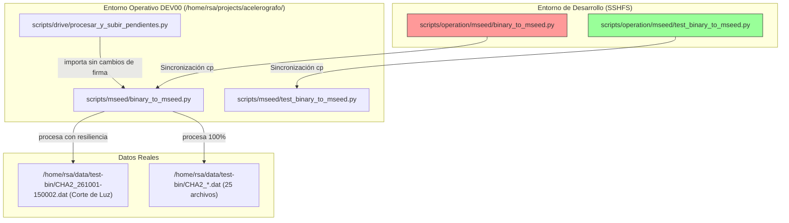
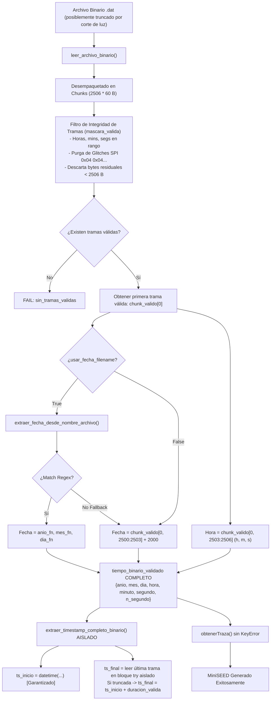

# Plan de Implementación: Resiliencia ante Archivos Incompletos y Desacople de Timestamp en `binary_to_mseed.py`

**Fecha**: 2026-10-27  
**Proyecto**: `RSA-Acelerografo` (`montajes/acelerografo-DEV00`)  
**Diagnósticos base**: 
* [`2026-10-26_diagnostico_desacople_timestamp_archivos_incompletos_binary_to_mseed.md`](file:///home/rsa/git/montajes/acelerografo-DEV00/docs/analysis/2026-10-26_diagnostico_desacople_timestamp_archivos_incompletos_binary_to_mseed.md)
* [`2026-10-26_diagnostico_vulnerabilidades_firmware_dspic_y_glitches_spi.md`](file:///home/rsa/git/montajes/acelerografo-DEV00/docs/analysis/2026-10-26_diagnostico_vulnerabilidades_firmware_dspic_y_glitches_spi.md)  
**ADRs de referencia**:
* [ADR-007: Estrategia Dual de Fechas en Conversión a miniSEED (USAR_FECHA_FILENAME)](file:///home/rsa/git/montajes/acelerografo-DEV00/docs/adr/007_estrategia_dual_fecha_mseed.md)
* [ADR-026: Dispersión Vectorizada O(N) y Blindaje SPI en binary_to_mseed](file:///home/rsa/git/montajes/acelerografo-DEV00/docs/adr/026_dispersion_vectorizada_gaps_y_blindaje_spi_binary_to_mseed.md)

**Objetivo**: Erradicar el fallo en cascada ante archivos truncados por corte abrupto de energía (`KeyError: 'anio'`), desacoplar la validación de tiempo del estado de la última trama física, otorgar autonomía absoluta a `leer_archivo_binario` para la extracción de fecha y hora válidas (respetando la directriz dual de fecha por nombre de archivo o por hardware según ADR-007), incorporar el test unitario sintético **T12** y certificar el 100% de éxito en la conversión de los 25 archivos reales de la estación `CHA02`.

---

## 1. Prerequisitos y Protocolo de Ejecución SSHFS

> [!CAUTION]
> **Regla de Restricción SSHFS Activa ([`restriccion_sshfs.md`](file:///home/rsa/git/.agents/rules/restriccion_sshfs.md))**:
> El Agente opera sobre el sistema de archivos remoto montado en `montajes/acelerografo-DEV00` mediante SSHFS y **tiene estrictamente prohibido ejecutar comandos autónomos** en la terminal local.
> 
> **Protocolo obligatorio para toda la ejecución**:
> 1. **Edición**: El Agente modifica y crea el código exclusivamente sobre el montaje.
> 2. **Delegación de Comandos**: En cada checkpoint, el Agente proveerá los bloques Bash copy-paste exactos para que el **usuario** los ejecute en la terminal remota de `DEV00`.
> 3. **Retroalimentación**: Las salidas de consola se reportarán y analizarán a través del archivo [`logs.tmp`](file:///home/rsa/git/logs.tmp). El Agente no avanzará a la siguiente fase hasta verificar la salida en `logs.tmp`.

| Prerrequisito | Estado | Verificación |
|---|---|---|
| Entorno virtual `.venv` con ObsPy y NumPy | ✅ Disponible | En DEV00: `.venv/bin/python3 -c "import obspy, numpy; print('OK')"` |
| Suite unitaria sintética (T1 a T11) | ✅ Operativa | En DEV00: `.venv/bin/python3 scripts/mseed/test_binary_to_mseed.py` (12 tests OK) |
| Archivo patológico por apagón | ✅ Disponible | `/home/rsa/data/test-bin/CHA2_261001-150002.dat` |
| Lote completo de validación CHA02 | ✅ Disponible | 25 archivos `.dat` en `/home/rsa/data/test-bin/` |
| Archivo puente de logs | ✅ Activo | [`logs.tmp`](file:///home/rsa/git/logs.tmp) en la raíz del workspace |

---

## 2. Mapa de Archivos Afectados y Dependencias



### Superficie de Cambio

| Archivo | Acción | Descripción del Cambio |
|---|---|---|
| [`scripts/operation/mseed/binary_to_mseed.py`](file:///home/rsa/git/montajes/acelerografo-DEV00/scripts/operation/mseed/binary_to_mseed.py) | **MODIFICAR** | 1. Autonomía de fecha/hora en `leer_archivo_binario`.<br>2. Aislamiento de lectura en `extraer_timestamp_completo_binario`.<br>3. Resiliencia en `extraer_tiempo_binario` y `procesar_archivo_individual`. |
| [`scripts/operation/mseed/test_binary_to_mseed.py`](file:///home/rsa/git/montajes/acelerografo-DEV00/scripts/operation/mseed/test_binary_to_mseed.py) | **MODIFICAR** | Incorporar **Test T12** (`test_archivo_truncado_por_apagon_conserva_fecha_t12`). |
| [`scripts/operation/drive/procesar_y_subir_pendientes.py`](file:///home/rsa/git/montajes/acelerografo-DEV00/scripts/operation/drive/procesar_y_subir_pendientes.py) | **NO TOCAR** | Se preserva 100% la firma de funciones y compatibilidad regresiva. |

---

## 3. Diagrama de Flujo de Resiliencia Temporal



---

## 4. Fases de Implementación

---

### Fase 1: Autonomía de Fecha y Hora en `leer_archivo_binario`

**Objetivo**: Garantizar que `tiempo_binario_validado` contenga siempre y de forma incondicional todas las llaves temporales (`'anio'`, `'mes'`, `'dia'`, `'hora'`, `'minuto'`, `'segundo'`, `'n_segundo'`), derivándolas de la primera trama válida en memoria (`chunk_valido[0]`) y del nombre de archivo si `usar_fecha_filename=True`.

#### Contrato del Diccionario `tiempo_binario_validado`
```python
tiempo_binario_validado = {
    "anio": int,        # Ej: 2026 (4 dígitos)
    "anio_s": str,      # "2026"
    "mes": int,         # 1 a 12
    "mes_s": str,       # "01" a "12" (zfill 2)
    "dia": int,         # 1 a 31
    "dia_s": str,       # "01" a "31" (zfill 2)
    "hora": int,        # 0 a 23
    "hora_s": str,      # "00" a "23" (zfill 2)
    "minuto": int,      # 0 a 59
    "minuto_s": str,    # "00" a "59" (zfill 2)
    "segundo": int,     # 0 a 59
    "segundo_s": str,   # "00" a "59" (zfill 2)
    "n_segundo": int    # hora * 3600 + minuto * 60 + segundo
}
```

#### Acciones
1. En [`scripts/operation/mseed/binary_to_mseed.py`](file:///home/rsa/git/montajes/acelerografo-DEV00/scripts/operation/mseed/binary_to_mseed.py), dentro de `leer_archivo_binario` (líneas 273-292):
   * Reemplazar la construcción condicional dependiente de `ts_inicio`.
   * Extraer la fecha y hora base:
     ```python
     # Construir tiempo_binario desde la primera trama VÁLIDA comprobada
     primer_tiempo_valido = int(tiempos_np[0])
     h_val = primer_tiempo_valido // 3600
     m_val = (primer_tiempo_valido % 3600) // 60
     s_val = primer_tiempo_valido % 60

     # Determinación de fecha conforme al ADR-007
     fecha_determinada = None
     if usar_fecha_filename:
         fecha_determinada = extraer_fecha_desde_nombre_archivo(archivo_binario)

     if fecha_determinada is None:
         # Fallback a hardware: extraer de la primera trama válida del chunk
         # chunk_valido[0] contiene la primera trama que superó los filtros
         anio_hw = int(chunk_valido[0, 2500]) + 2000
         mes_hw = int(chunk_valido[0, 2501])
         dia_hw = int(chunk_valido[0, 2502])
         fecha_determinada = {
             "anio": anio_hw, "anio_s": str(anio_hw),
             "mes": mes_hw, "mes_s": str(mes_hw).zfill(2),
             "dia": dia_hw, "dia_s": str(dia_hw).zfill(2)
         }

     tiempo_binario_validado = {
         "anio": fecha_determinada["anio"],
         "anio_s": fecha_determinada["anio_s"],
         "mes": fecha_determinada["mes"],
         "mes_s": fecha_determinada["mes_s"],
         "dia": fecha_determinada["dia"],
         "dia_s": fecha_determinada["dia_s"],
         "hora": h_val,
         "hora_s": str(h_val).zfill(2),
         "minuto": m_val,
         "minuto_s": str(m_val).zfill(2),
         "segundo": s_val,
         "segundo_s": str(s_val).zfill(2),
         "n_segundo": primer_tiempo_valido
     }
     ```
2. Asegurar que `chunk_valido` conserve al menos la primera trama encontrada a lo largo de las lecturas por bloques o preservar `primera_trama_valida` en el bucle `while True:`.

#### Comprobación (Checkpoint 1)
Inspección estática de código verificando que no exista ningún camino donde `tiempo_binario_validado` carezca de `'anio'`.

---

### Fase 2: Aislamiento y Resiliencia en `extraer_timestamp_completo_binario`

**Objetivo**: Aislar la obtención de `ts_inicio` y `ts_final`. Si un archivo termina con bytes cortados a mitad de trama por corte de luz, la última trama defectuosa no debe invalidar el inicio del archivo ni generar excepciones fatales.

#### Acciones
1. En [`scripts/operation/mseed/binary_to_mseed.py`](file:///home/rsa/git/montajes/acelerografo-DEV00/scripts/operation/mseed/binary_to_mseed.py), refactorizar `extraer_timestamp_completo_binario`:
   ```python
   def extraer_timestamp_completo_binario(archivo_binario, usar_fecha_filename=False):
       ts_inicio = None
       ts_final = None

       try:
           with open(archivo_binario, "rb") as f:
               # 1. Leer primera trama (aislado)
               primera_trama = np.fromfile(f, dtype=np.uint8, count=2506)
               if primera_trama.size == 2506:
                   hora_i = int(primera_trama[2503])
                   min_i = int(primera_trama[2504])
                   seg_i = int(primera_trama[2505])
                   
                   fecha_info = extraer_fecha_desde_nombre_archivo(archivo_binario) if usar_fecha_filename else None
                   if fecha_info:
                       anio_i, mes_i, dia_i = fecha_info['anio'], fecha_info['mes'], fecha_info['dia']
                   else:
                       anio_i = int(primera_trama[2500]) + 2000
                       mes_i = int(primera_trama[2501])
                       dia_i = int(primera_trama[2502])
                   
                   try:
                       ts_inicio = datetime.datetime(anio_i, mes_i, dia_i, hora_i, min_i, seg_i)
                   except Exception:
                       ts_inicio = None

               # 2. Leer última trama (aislado y tolerante a truncamiento)
               try:
                   f.seek(0, 2)
                   tamano_total = f.tell()
                   if tamano_total >= 2506:
                       f.seek(-2506, 2)
                       ultima_trama = np.fromfile(f, dtype=np.uint8, count=2506)
                       if ultima_trama.size == 2506:
                           hora_f = int(ultima_trama[2503])
                           min_f = int(ultima_trama[2504])
                           seg_f = int(ultima_trama[2505])
                           
                           if usar_fecha_filename and fecha_info:
                               anio_f, mes_f, dia_f = fecha_info['anio'], fecha_info['mes'], fecha_info['dia']
                           else:
                               anio_f = int(ultima_trama[2500]) + 2000
                               mes_f = int(ultima_trama[2501])
                               dia_f = int(ultima_trama[2502])
                           
                           ts_final = datetime.datetime(anio_f, mes_f, dia_f, hora_f, min_f, seg_f)
               except Exception:
                   ts_final = None  # Si la cola está corrupta o truncada, NO anula ts_inicio
       except Exception:
           pass

       return ts_inicio, ts_final
   ```

#### Comprobación (Checkpoint 2)
Verificación de ejecución con archivos truncados artificialmente donde `ts_inicio` retorne un `datetime` válido y `ts_final` retorne `None` sin lanzar excepciones.

---

### Fase 3: Resiliencia de Entrada en `procesar_archivo_individual` y `extraer_tiempo_binario`

**Objetivo**: Evitar que el archivo sea descartado de entrada si la trama física 0 contiene ruido eléctrico de arranque, confiando en el resultado validado de `leer_archivo_binario`.

#### Acciones
1. En [`scripts/operation/mseed/binary_to_mseed.py`](file:///home/rsa/git/montajes/acelerografo-DEV00/scripts/operation/mseed/binary_to_mseed.py):
   * En `extraer_tiempo_binario`: Si la primera trama física tiene valores fuera de rango (como hora $> 23$ o año fuera de rango), retornar `None` o permitir que `procesar_archivo_individual` proceda a `leer_archivo_binario`.
   * En `procesar_archivo_individual` (L611-L627):
     Si `tiempo_binario` preliminar es `None`, no abortar inmediatamente si el archivo tiene tamaño superior a 2506 bytes; permitir que `leer_archivo_binario` busque la primera trama válida. Si `leer_archivo_binario` encuentra tramas válidas, usar `tiempo_binario_validado` como referencia canónica para el nombrado y la conversión.

#### Comprobación (Checkpoint 3)
Verificar que un archivo sintético cuya trama 0 sea puro ruido pero cuyas tramas 1 a 10 sean válidas, proceda a la conversión sin ser rechazado tempranamente.

---

### Fase 4: Suite de Pruebas Unitarias — Implementación de Test T12

**Objetivo**: Añadir el test **T12** en `test_binary_to_mseed.py` para certificar la resiliencia ante archivos truncados por corte abrupto de energía y blindaje ante `KeyError: 'anio'`.

#### Especificación del Test T12
* **Nombre**: `test_archivo_truncado_por_apagon_conserva_fecha_t12`
* **Escenario**:
  1. Generar sintéticamente un archivo binario con 10 tramas continuas válidas (segundos 00 a 09 a las 15:00:00).
  2. Inyectar al final del archivo 1,200 bytes residuales (trama cortada a la mitad) con bytes aleatorios simulando el apagón repentino.
  3. Ejecutar `leer_archivo_binario` y `procesar_archivo_individual`.
  4. **Aserciones esperadas**:
     * No debe lanzar excepción `KeyError: 'anio'` ni ninguna excepción no controlada.
     * `tiempo_binario_validado` debe contener fecha completa y hora `15:00:00`.
     * Las trazas MiniSEED deben contener exactamente 10 segundos ($2,500$ muestras a 250 Hz).
     * El archivo `.mseed` resultante debe ser inspeccionable por ObsPy con cabeceras STEIM1 íntegras.

#### Comprobación (Checkpoint 4)
Comando copy-paste para DEV00:
```bash
.venv/bin/python3 scripts/mseed/test_binary_to_mseed.py
```
* **Criterio de éxito**: 13 tests ejecutados en $< 0.15$ s, todos con status `OK`.

---

### Fase 5: Certificación Masiva de Campo con CHA02 (25/25)

**Objetivo**: Sincronizar el código actualizado al entorno operativo de DEV00 y certificar la conversión exitosa del 100% de los archivos de CHA02 en `/home/rsa/data/test-bin`, prestando especial atención al archivo del apagón `CHA2_261001-150002.dat`.

#### Acciones y Comandos Delegados para DEV00

1. **Sincronización de scripts**:
   ```bash
   cp -v /home/rsa/git/RSA-Acelerografo/scripts/operation/mseed/*.py scripts/mseed/
   ```

2. **Certificación Unitaria en DEV00**:
   ```bash
   .venv/bin/python3 scripts/mseed/test_binary_to_mseed.py > /home/rsa/git/logs.tmp 2>&1
   ```

3. **Prueba específica sobre el archivo patológico `CHA2_261001-150002.dat`**:
   ```bash
   .venv/bin/python3 scripts/mseed/binary_to_mseed.py \
     -f /home/rsa/data/test-bin/CHA2_261001-150002.dat \
     -o /tmp/test_mseed_resiliencia/ \
     -c /home/rsa/projects/acelerografo/configuracion/configuracion_mseed.json \
     -v > /home/rsa/git/logs.tmp 2>&1
   ```
   * **Criterio de éxito**: Conversión `OK`, sin `KeyError: 'anio'`, MiniSEED generado con las tramas registradas hasta el instante del apagón.

4. **Procesamiento del Lote Completo (25 archivos)**:
   ```bash
   mkdir -p /tmp/test_mseed_resiliencia/
   for f in /home/rsa/data/test-bin/*.dat; do
     echo "=== Procesando $(basename $f) ===" >> /home/rsa/git/logs.tmp
     .venv/bin/python3 scripts/mseed/binary_to_mseed.py \
       -f "$f" \
       -o /tmp/test_mseed_resiliencia/ \
       -c /home/rsa/projects/acelerografo/configuracion/configuracion_mseed.json \
       >> /home/rsa/git/logs.tmp 2>&1
   done
   ```
   * **Criterio de éxito**: **25 de 25 archivos convertidos (100% de éxito)**, sin errores no controlados.

---

## 5. Criterios de Aceptación y Cierre

1. **Robustez ante Apagones**: Ningún archivo con cola truncada o tramas residuales genera excepciones en Python ni anula los metadatos de inicio.
2. **Cero Regresiones**: Los 12 tests preexistentes (T1 a T11) y la Fase 6 de dispersión $O(N)$ siguen pasando al 100%.
3. **Adherencia al ADR-007**: Se respeta la directriz dual: si `USAR_FECHA_FILENAME=True`, la fecha proviene del nombre del archivo; si `False`, de la primera trama válida comprobada.
4. **Completitud del Lote**: 25 de 25 archivos de CHA02 procesados satisfactoriamente en DEV00.
