# ayuda.sh — Contexto para Agentes IA

> Guía interactiva de línea de comandos en terminal que documenta de forma centralizada las utilidades de operación, control de adquisición continua, daemons en Supervisor, sincronización con Google Drive, conversión offline de pendientes, empaquetado diario SFTP y diagnóstico de hardware de la estación.

**Ruta**: `scripts/task/ayuda.sh` (instalado globalmente como `/usr/local/bin/ayuda`)  
**LOC**: ~67 | **Lenguaje**: Bash | **Dependencias**: Entorno del sistema (`systemd`, `supervisorctl`, scripts de `scripts/task/`)  
**Proceso**: Script de ejecución interactiva bajo demanda por el operador local o remoto desde cualquier terminal SSH.

---

## Arquitectura de Comandos

```mermaid
graph TD
    USER["Operador / Agente IA<br/>(Terminal SSH o consola local)"]
    AYUDA["/usr/local/bin/ayuda<br/>(scripts/task/ayuda.sh)"]

    subgraph "Subsistema de Adquisición (SPI)"
        RC["registrocontinuo start|stop|restart"]
        SYS["sudo systemctl status rsa-acelerografo.service"]
        COMP["comprobar<br/>(Trama física viva)"]
        RST["sudo resetmaster<br/>(Reset HW dsPIC33)"]
    end

    subgraph "Puesta al Día y Conversión Offline"
        PEND["procesarpendientes --convert-only<br/>(--purge-dat, --batch-size, --dry-run)"]
    end

    subgraph "Empaquetado y Exportación SFTP"
        EMP["empaquetar<br/>(--date, --all-days, --delete-source, --mseed, --events, --logs)"]
    end

    subgraph "Sincronización Cloud (Google Drive)"
        DRV["gestor_archivos_acq.py<br/>(Subida manual / --dry-run / --purge-registry)"]
        LOGS_D["log-files/gestor_acq.log"]
        REG_D["log-files/uploaded_files_registry.json"]
    end

    subgraph "Gestión de Daemons (Supervisor)"
        SUP_ST["sudo supervisorctl status"]
        SUP_OP["sudo supervisorctl start|stop|restart|tail"]
        DAEMONS["config_server, gpd_worker,<br/>mqtt_coordinator, stream_processor"]
    end

    subgraph "Mantenimiento e Infraestructura"
        WIFI["sudo wifiap enable|disable|status"]
        DIAG["diagnostico [acquisition|sensor|drive]"]
        INFO["informacion<br/>(df -h, rutas del proyecto)"]
    end

    USER -->|Ejecuta| AYUDA
    AYUDA -.->|Documenta| RC
    AYUDA -.->|Documenta| SYS
    AYUDA -.->|Documenta| COMP
    AYUDA -.->|Documenta| RST
    AYUDA -.->|Documenta| PEND
    AYUDA -.->|Documenta| EMP
    AYUDA -.->|Documenta| DRV
    AYUDA -.->|Documenta| SUP_ST
    AYUDA -.->|Documenta| WIFI
    AYUDA -.->|Documenta| DIAG
    AYUDA -.->|Documenta| INFO
```

---

## Secciones y Comandos Documentados

| Sección | Comando / Acción | Propósito Operativo |
|---|---|---|
| **Registro Continuo y Adquisición** | `registrocontinuo start\|stop\|restart` | Control del servicio systemd de adquisición en C y reseteo del microcontrolador dsPIC33. |
| | `sudo systemctl status rsa-acelerografo.service` | Estado del daemon C y journald. |
| | `comprobar` | Muestra en tiempo real aceleración triaxial, archivo activo `.dat` y sincronización NTP/GPS. |
| | `sudo resetmaster` | Dispara pulso de reseteo por hardware al microcontrolador dsPIC33. |
| **Google Drive y Sincronización** | `gestor_archivos_acq.py` | Ejecución manual de sincronización, dry-run y depuración `--purge-registry`. |
| | `tail -f $PROJECT_LOCAL_ROOT/log-files/gestor_acq.log` | Monitoreo en vivo de resultados de subida. |
| | `cat $PROJECT_LOCAL_ROOT/log-files/uploaded_files_registry.json` | Registro de archivos exitosos y fallidos protegidos. |
| **Puesta al Día y Conversión** | `procesarpendientes --convert-only` | Conversión local resiliente de binarios a miniSEED sin conexión de red. |
| | `procesarpendientes --convert-only --purge-dat` | Convierte y purga los `.dat` cuyo `.mseed` ya existe verificado. |
| | `procesarpendientes --convert-only --dry-run` | Diagnóstico previo de cupo dinámico y simulación. |
| **Empaquetado y Exportación (SFTP)** | `empaquetar --date YYYY-MM-DD` | Empaqueta MiniSEED de un día específico a `.tar.gz` con checksum `.sha256`. |
| | `empaquetar --date YYYY-MM-DD --delete-source` | Empaqueta y purga archivos originales tras verificar integridad del `.tar.gz`. |
| | `empaquetar --start-date ... --end-date ...` | Empaquetado por rango de fechas calendario. |
| | `empaquetar --all-days` | Empaqueta todo el historial acumulado excluyendo automáticamente el día actual. |
| | `empaquetar --events \| --continuous \| --logs` | Empaqueta tipos alternativos (eventos, binarios brutos o logs del sistema). |
| | `empaquetar --dry-run` | Simulación de empaquetado sin escrituras ni borrados. |
| **Supervisor (Daemons)** | `sudo supervisorctl status\|start\|stop\|restart\|tail` | Control de procesos de fondo (`config_server`, `gpd_worker`, `mqtt_coordinator`, `stream_processor`). |
| **Punto de Acceso WiFi** | `sudo wifiap enable\|disable\|status` | Gestión de la interfaz inalámbrica ad-hoc de mantenimiento. |
| **Diagnóstico Automatizado** | `diagnostico [acquisition\|sensor\|drive]` | Ejecuta auditoría automatizada y genera reporte estructurado para agente IA. |
| **Información del Sistema** | `informacion` | Resumen de ocupación de almacenamiento (`df -h`) y rutas del entorno. |

---

## Entorno y Despliegue

* **Instalación**: El script se despliega mediante `deploy.sh` o `update.sh` (opción 3 de `menu.sh`) copiándose a `/usr/local/bin/ayuda` con permisos de ejecución (`chmod +x`).
* **Variables Clave**: Hace referencia a `$PROJECT_LOCAL_ROOT` (provista por `/usr/local/bin/project_paths`), correspondiente al directorio `/home/rsa/projects/acelerografo` en producción.
