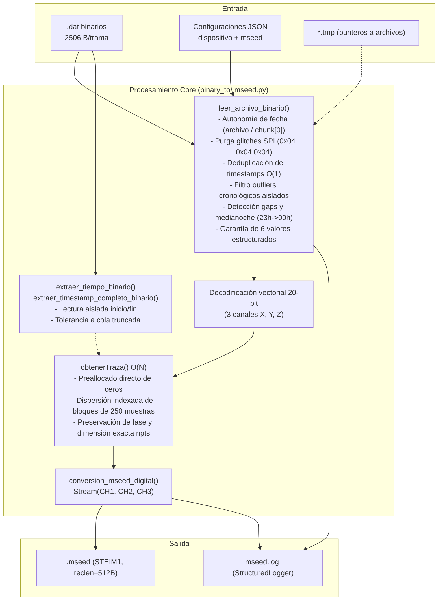

# binary_to_mseed.py — Contexto para Agentes IA

> Motor de conversión sismológica de archivos binarios `.dat` (tramas de 2506 bytes del acelerógrafo) a formato MiniSEED (STEIM1) con dispersión vectorizada $O(N)$, preservación de fase, deduplicación de tramas, purga de anomalías de bus SPI y resiliencia ante archivos truncados por corte abrupto de energía.

**Ruta**: `scripts/operation/mseed/binary_to_mseed.py`  
**LOC**: 1086 | **Lenguaje**: Python 3 | **Dependencias**: `obspy`, `numpy`, `structured_logger`, `json`, `argparse`, `glob`, `re`, `datetime`  
**Proceso**: Ejecutado como script CLI (`1`, `2`, `3`, `4`) o importado por `procesar_y_subir_pendientes.py`  

---

## Arquitectura

---

## Modos de Operación y CLI

Soporta ejecución posicional simple o flags extendidos:

| Modo | Argumento CLI | Flags alternativos | Entrada | Salida |
|---|---|---|---|---|
| **1** | `1` | `--continuous` | Lee línea 2 de `NombreArchivoRegistroContinuo.tmp` | `directorios.archivos_mseed` (o `--output-dir`) |
| **2** | `2` | `--event` | Lee línea 1 de `NombreArchivoEventoExtraido.tmp` | `directorios.eventos_extraidos` |
| **3** | `3 <archivo>` | `-f <archivo>`, `--file <archivo>` | Archivo binario individual | `directorios.archivos_mseed` (o `--output-dir`) |
| **4** | `4` | `-d <directorio>`, `--dir <directorio>` | Todos los `*.dat` del directorio | `directorios.archivos_mseed` (o `--output-dir`) |

### Parámetros opcionales CLI
* `--output-dir`, `-o`: Sobrescribe el directorio de destino configurado en JSON, permitiendo aislar salidas de prueba (ej. `tmp-files/test_mseed_resiliencia`) sin permisos de superusuario ni colisiones en el directorio oficial `/home/rsa/data/mseed/`.
* `-f`: Alias corto para `--file`.
* `-d`: Alias corto para `--dir`.

---

## Pipeline y Resiliencia Sismológica

### 1. Resiliencia ante Cortes de Energía y Desacople de Timestamp
* **Autonomía de Fecha**: `leer_archivo_binario` determina la fecha legítima directamente desde el nombre del archivo (si `usar_fecha_filename=True`, conforme a [ADR-007](file:///home/rsa/git/montajes/acelerografo-DEV00/docs/adr/007_estrategia_dual_fecha_mseed.md)) o desde la primera trama válida en memoria (`chunk_valido[0]`). Esto garantiza que `tiempo_binario_validado` siempre contenga `'anio'`, `'mes'`, `'dia'`, `'hora'`, `'minuto'`, `'segundo'` y `'n_segundo'`.
* **Aislamiento de Lectura en Cola**: `extraer_timestamp_completo_binario` ejecuta la lectura de la primera trama y de la última trama en bloques `try/except` independientes. Si un apagón abrupto interrumpe la escritura y deja una última trama truncada o incompleta ($< 2506$ bytes), no se anula el timestamp de inicio ni se aborta el archivo.
* **Tolerancia a Ruido Inicial**: `procesar_archivo_individual` delega la validación de cabeceras directamente al filtrado vectorial en memoria; si la trama física 0 contiene ruido eléctrico pero existen tramas subsiguientes válidas, el archivo se procesa normalmente recuperando los datos sísmicos válidos.

### 2. Desempaquetado y Filtrado Vectorial en `leer_archivo_binario`
* Procesa chunks de 60 tramas ($150{,}360$ bytes).
* **Validación de cabecera**: Descarta tramas fuera de rango horario (`hora<=23`, `minuto<=59`, `segundo<=59`) o de calendario (`año`, `mes`, `día`).
* **Protección contra Glitch SPI (Fase 6 / H7)**: Purga tramas donde todos los bytes de tiempo son idénticos (`0x04 0x04 0x04 0x04 0x04 0x04`).
* **Deduplicación Vectorial**: `np.unique` sobre timestamps preserva la primera ocurrencia cronológica y rebanado tridimensional `(3, N_tramas, fsample)`.
* **Filtro de Coherencia Cronológica**: Purga tramas outlier intermedias ($|t_k - t_{k-1}| > 60$ s con retorno inmediato a continuidad circundante).
* **Acotamiento de Medianoche**: Suma modular $+86400$ s acotada estrictamente a la ventana limítrofe $t_{\text{ant}} \ge 86000$ (hora 23) y $t_{\text{sig}} \le 3600$ (hora 00), evitando falsos cruces diurnos de 24 horas.

### 3. Dispersión Vectorial en `obtenerTraza`
* **Preallocado Directo**: `data_completo = np.zeros(npts_completo, dtype=np.int32)`.
* **Dispersión $O(N)$**: Calcula directamente la posición de inserción de cada segundo presente `idx_destino = seg_relativo * fsample` y copia los bloques de 250 muestras.
* **Integridad de Fase**: Los datos registrados conservan su segundo absoluto en el MiniSEED; los segundos faltantes quedan rellenos con ceros continuos sin truncar la traza.

---

## Componentes y Funciones Clave

| Elemento | Firma / Tipo | Descripción |
|---|---|---|
| `leer_archivo_binario` | `(archivo, logger, usar_fecha) -> (datos, gaps, t_lectura, ts_ini, ts_fin, t_validado)` | Lee tramas, valida cabeceras, purga tramas corruptas, detecta gaps y retorna 6 valores estructurados con fecha garantizada. |
| `obtenerTraza` | `(nombre, num_ch, data, t_bin, gaps, cfg) -> obspy.Trace` | Genera traza ObsPy triaxial con header SEED, sample rate, npts exacto y ceros vectorizados en gaps. |
| `conversion_mseed_digital` | `(fileName, path, tiempo, datos, gaps, cfg, logger) -> None` | Construye el `Stream` con los 3 canales y exporta en formato STEIM1 (reclen 512B). |
| `procesar_archivo_individual` | `(bin_file, out_dir, codigo, cfg, logger, usar_fecha) -> (bool, msg, info)` | Orquesta la lectura, sincroniza el tiempo canónico validado y ejecuta la conversión con tolerancia a tramas iniciales ruidosas. |
| `extraer_timestamp_completo_binario` | `(archivo, usar_fecha) -> (ts_inicio, ts_final)` | Extrae timestamps de inicio y fin con bloques aislados y tolerancia total a truncamientos de cola. |
| `extraer_tiempo_binario` | `(archivo, usar_fecha) -> dict` | Interfaz pública requerida por `procesar_y_subir_pendientes.py` (extrae timestamp de primera trama). |
| `extraer_fecha_desde_nombre_archivo`| `(path) -> dict` | Extrae año, mes y día mediante regex del nombre `CODIGO_AAMMDD-HHMMSS.dat`. |

---

## Configuraciones y Entorno

* `PROJECT_LOCAL_ROOT`: Variable de entorno obligatoria (`/home/rsa/projects/acelerografo`).
* `configuracion_dispositivo.json`: Define rutas de directorios (`RC`, `ED`, `MSEED`).
* `configuracion_mseed.json`: Define metadatos SEED (`CODIGO`, `SENSOR`, `MUESTREO=250`, `RED=EC`, `CANAL=ZNE`, `CALIDAD=D`, `USAR_FECHA_FILENAME`).

---

## Rendimiento y Robustez Certificados (Raspberry Pi 3B+)

| Caso de Prueba | Entrada | Tiempo de Conversión | Duración MiniSEED | Muestras | Estatus |
|---|---|---|---|---|---|
| **Archivo continuo nominal** | ~3600 tramas (8.7 MB) | **0.95 s** | 3599.996 s (1.00 h) | 900,000 | ✅ OK |
| **Archivo con gaps masivos (CHA02)** | 100 tramas + 3500s gaps | **0.08 s** | 3599.996 s (1.00 h) | 900,000 | ✅ OK |
| **Archivo interrumpido por apagón (`CHA2_261001-150002.dat`)** | 3179 tramas (~7.8 MB) | **0.83 s** | 3177.996 s (~52.9 min) | 794,500 | ✅ OK |
| **Glitch SPI (04:04:04 en hora 17)** | Trama patológica real | **0.95 s** | 3599.996 s (1.00 h) | 900,000 | ✅ OK |
| **Lote Real Completo** | 30 archivos `/home/rsa/data/test-bin` | **~24.5 s** total | 30 archivos procesados | N/A | ✅ 30/30 (100%) |

---

## Limitaciones Conocidas / Pendientes

1. **Bug de Medianoche en Firmware dsPIC**: El reloj del firmware MikroC resetea la hora a cero pero mantiene congelada la fecha del día de encendido. En `binary_to_mseed.py` se mitiga exitosamente mediante `USAR_FECHA_FILENAME=True` según [ADR-007](file:///home/rsa/git/montajes/acelerografo-DEV00/docs/adr/007_estrategia_dual_fecha_mseed.md); la solución definitiva por hardware se implementará en la migración a MPLABX.
2. **Sin compresión posterior**: Los archivos MiniSEED se graban con STEIM1 en bloques de 512 bytes sin compresión gzip adicional a nivel de archivo.
3. **Pérdida de tramas descartadas**: Las tramas con cabecera de tiempo corrupta se purgan; el segundo correspondiente se rellena con ceros continuos en ObsPy para preservar la alineación de fase.
