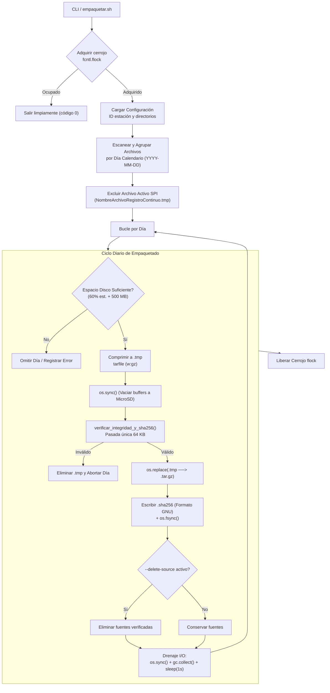

# empaquetar_archivos.py — Contexto para Agentes IA

> Herramienta modular de compresión diaria, verificación criptográfica de integridad y exportación por lotes para contingencia SFTP en estaciones acelerográficas.

**Ruta**: `scripts/operation/export/empaquetar_archivos.py` (desplegado en `$PROJECT_LOCAL_ROOT/scripts/export/empaquetar_archivos.py`)  
**LOC**: ~680 | **Lenguaje**: Python 3 | **Dependencias**: estándar (`tarfile`, `hashlib`, `shutil`, `fcntl`, `gc`, `time`, `argparse`)  
**Proceso**: Invocado interactivamente vía wrapper CLI `/usr/local/bin/empaquetar`, scripts de exportación o cron de contingencia.

---

## Arquitectura

El módulo estructura el ciclo de empaquetado diario garantizando la no concurrencia, la protección de archivos en adquisición activa, la integridad de los datos antes de purgar fuentes y la estabilidad de memoria/I/O en hardware limitado (Raspberry Pi con 0.9 GB de RAM).

---

## Configuraciones / Variables de Entorno

* **`PROJECT_LOCAL_ROOT`**: Directorio raíz local del proyecto (default: `/home/rsa/projects/acelerografo`).
* **Ruta de salida por defecto**: `/home/rsa/data/packages/` (o `$PROJECT_LOCAL_ROOT/packages`).
* **Bloqueo `/tmp/empaquetar_archivos.lock`**: Exclusión mutua que impide ejecuciones simultáneas.
* **Salvaguarda de logs**: Bloqueo absoluto que prohíbe el uso de `--delete-source` cuando se empaqueta tipo `--logs`.

---

## Componentes / Funciones Clave

| Elemento | Descripción |
|---|---|
| `adquirir_cerrojo(lock_path)` | Adquiere cerrojo no bloqueante `fcntl.flock`. Retorna descriptor o `None`. |
| `obtener_archivos_activos(...)` | Identifica el archivo binario continuo en uso mediante `NombreArchivoRegistroContinuo.tmp`. |
| `extraer_fecha_de_archivo(path)` | Extrae fecha calendario desde patrones de nombres sísmicos (`YYYYMMDD` o `YYMMDD`) con fallback a `mtime`. |
| `verificar_espacio_para_empaquetar(...)` | Comprueba si el disco tiene espacio libre $\ge$ 60% del tamaño original + 500 MB de margen de seguridad. |
| `verificar_integridad_y_sha256(path)` | **Optimización unificada:** Comprueba estructura de `tarfile` y calcula suma SHA-256 en una sola pasada de lectura (bloques de 64 KB). |
| `empaquetar_dia(...)` | Procesa un día: genera `<ID>_<YYYYMMDD>_<TIPO>.tar.gz` atómicamente, emite `.sha256` y purga fuentes si se solicita. |
| Drenaje I/O y memoria (`main`) | Invoca `os.sync()`, `gc.collect()` y `time.sleep(1.0)` entre días sucesivos para evitar saturación de RAM por *dirty page cache*. |

---

## Limitaciones Conocidas / TODOs

- MiniSEED utiliza compresión interna Steim-2 en origen, por lo que la compresión `gzip` solo reduce entre un 15% y 18% adicional del tamaño total en disco.
- El script no realiza subida de red; su entrega final es el directorio local `/home/rsa/data/packages/` para posterior extracción masiva vía SFTP.
