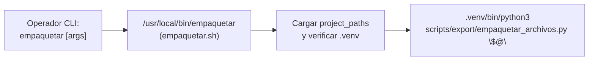

# empaquetar.sh — Contexto para Agentes IA

> Wrapper ejecutable del CLI para empaquetado diario y exportación SFTP, instalado como comando global `/usr/local/bin/empaquetar`.

**Ruta**: `scripts/task/empaquetar.sh` (instalado en `/usr/local/bin/empaquetar`)  
**LOC**: 27 | **Lenguaje**: Bash | **Dependencias**: `/usr/local/bin/project_paths`, entorno virtual Python  
**Proceso**: Invocado directamente por el operador desde cualquier ruta de la terminal SSH.

---

## Arquitectura

El script actúa como puente entre el usuario y el intérprete virtual de Python, resolviendo las rutas dinámicas institucionales y delegando los argumentos en `empaquetar_archivos.py`.

---

## Configuraciones / Variables de Entorno

* **`PROJECT_LOCAL_ROOT`**: Directorio base (default: `/home/rsa/projects/acelerografo`).
* **`/usr/local/bin/project_paths`**: Script fuente de configuración de entorno.
* **Instalación**: Automatizada por `deploy.sh` y `update.sh` (opción 3 de `menu.sh`).

---

## Componentes y Flujo Clave

| Elemento | Descripción |
|---|---|
| Carga de entorno | Evalúa `/usr/local/bin/project_paths` o `$HOME/projects/acelerografo/scripts/env/project_paths.sh`. |
| Validación de Python | Verifica la existencia de `.venv/bin/python3` antes de invocar la rutina. |
| Fallback dinámico | Si no encuentra el script en `PROJECT_LOCAL_ROOT`, resuelve la ruta relativa al repositorio de desarrollo. |
| Delegación transparente | Ejecuta `exec "$VENV_PYTHON" "$SCRIPT_PYTHON" "$@"` preservando los códigos de retorno y señales del proceso. |

---

## Limitaciones Conocidas / TODOs

- Requiere que el entorno virtual `.venv` esté previamente provisionado en la estación.
