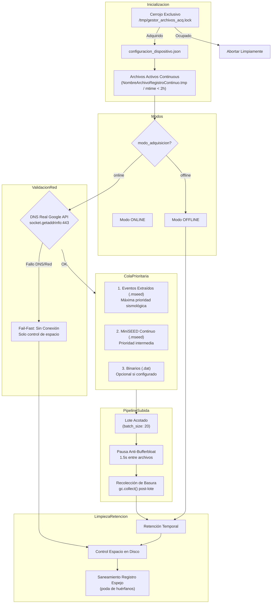

# gestor_archivos_acq.py — Contexto para Agentes IA

> Daemon/script Python robusto que gestiona el almacenamiento, sincronización con Google Drive y políticas de retención de archivos binarios (`.dat`), miniSEED continuo (`.mseed`) y eventos extraídos (`.mseed`). Incorpora cerrojo atómico exclusivo en `/tmp`, verificación DNS real contra `www.googleapis.com`, subida priorizada por lotes (`batch_size`), pausas anti-bufferbloat y recolección forzada de basura para evitar saturación de RAM y swap thrashing en Raspberry Pi 3B+.

**Ruta**: `scripts/operation/drive/gestor_archivos_acq.py`  
**LOC**: ~1050 | **Lenguaje**: Python 3 | **Ejecución**: Periódica (cron horaria mediante `scripts/task/registrocontinuo.sh` start)  
**Lockfile**: `/tmp/gestor_archivos_acq.lock` (`fcntl.flock` exclusivo no bloqueante)  

---

## Arquitectura y Flujo de Control



---

## Modos de Operación

### 1. Modo ONLINE (con conexión confirmada)

1. **Adquisición del Cerrojo**: `adquirir_cerrojo("/tmp/gestor_archivos_acq.lock")`. Si otro proceso o instancia cron está corriendo, termina inmediatamente con log de advertencia evitando acumulación de procesos durmientes y contienda de memoria.
2. **Detección de Archivos Activos**: `obtener_archivos_activos_continuous()` inspecciona `NombreArchivoRegistroContinuo.tmp` y filtra archivos binarios con `mtime` menor a 2 horas para evitar que la rotación horaria de `registro_continuo_4.5.0.c` sea eliminada o subida prematuramente.
3. **Verificación DNS Real**: Ejecuta `socket.getaddrinfo("www.googleapis.com", 443, timeout=5)`. Evita el falso positivo del antiguo ping a `8.8.8.8:53` cuando el router responde localmente pero el enlace wan o el resolver DNS están caídos.
4. **Subida Priorizada por Lotes (`batch_size`)**:
   - Procesa primero la cola de **eventos extraídos (`event`)** (máximo `batch_size`).
   - Luego la cola de **miniSEED continuo (`mseed`)** (máximo `batch_size`).
   - Finalmente **binarios (`continuous`)** si están habilitados en la configuración.
   - Aplica `time.sleep(1.5)` tras cada archivo subido para drenar buffers en módems celulares/ADSL (anti-bufferbloat).
   - Corta el ciclo anticipadamente (*fail-fast*) si un archivo falla por timeout o error de red, impidiendo saturación de socket.
   - Invoca `gc.collect()` tras cada fase de subida para desasignar memoria de tramas y payloads SSL de Google Client API.
5. **Políticas de Retención Temporal**:
   - `continuous > N días`: Elimina binarios viejos, protegiendo explícitamente los archivos activos detectados.
   - `mseed > N días` y `event > N días`: Elimina con verificación de estado en `drive_status_manager`.
6. **Control de Espacio en Disco**:
   - Si `% libre < umbral_minimo (10%)`: Desaloja `.dat` no activos; si persiste bajo umbral, desaloja `.mseed` continuo FIFO.
   - Si `% libre < umbral_critico (5%)`: Desaloja `.mseed` continuo FIFO; en última instancia desaloja eventos extraídos FIFO verificando no eliminar protegidos.
7. **Saneamiento del Registro Espejo**:
   - `limpiar_archivos_inexistentes()` compara el registro JSON local contra el sistema de archivos real y elimina huérfanos.
8. **Liberación Garantizada del Cerrojo**: En bloque `finally:` de `main()`.

### 2. Modo ONLINE (sin conexión o falla DNS)
- No intenta conectarse a Google Drive ni reintenta timeouts prolongados.
- Salta la subida y retención temporal, ejecutando únicamente el control de espacio en disco de emergencia para garantizar continuidad operativa del adquisidor C.

### 3. Modo OFFLINE
- Retención local según días configurados (`retener_dias.continuous` default 7, `event` default 30).
- Desalojo por espacio mínimo y crítico respetando archivos activos.

---

## Mecanismos Clave Anti-Livelock y Protección de Recursos

| Mecanismo | Implementación | Propósito / Beneficio |
|-----------|----------------|-----------------------|
| **Cerrojo Atómico de Proceso** | `fcntl.flock(lock_fd, fcntl.LOCK_EX \| fcntl.LOCK_NB)` | Garantiza una sola instancia activa en todo momento. Elimina acumulación de procesos por cuelgues de subida. |
| **Verificación DNS Real** | `socket.getaddrinfo("www.googleapis.com", 443)` | Evita falsos positivos de red cuando el gateway responde a IP pero DNS o WAN fallan. |
| **Colas Prioritarias Desacopladas** | `event` (P1) → `mseed` (P2) → `continuous` (P3) | Sube prioritariamente datos sismológicos críticos antes que el flujo continuo masivo. |
| **Procesamiento Acotado por Lotes** | `drive.config.batch_size` (default: 20) | Previene saturación de RAM por escaneo y carga de listas masivas de miles de archivos. |
| **Pausa Anti-Bufferbloat** | `time.sleep(1.5)` | Evita saturar colas de subida de routers/módems celulares 3G/4G, previniendo latencia SSH inmanejable. |
| **Recolección Forzada de Basura** | `gc.collect()` tras lotes de subida | Libera inmediatamente memoria acumulada por deserialización SSL y peticiones HTTP de `google-api-python-client`. |
| **Protección de Binario Activo** | Lectura de `NombreArchivoRegistroContinuo.tmp` + delta `mtime < 2h` | Previene borrado o corrupción del archivo en escritura activa por `registro_continuo_4.5.0.c`. |

---

## Funciones Principales

| Función | Descripción |
|---------|-------------|
| `adquirir_cerrojo(lock_path)` | Adquiere candado exclusivo no bloqueante vía `fcntl.flock`. Cierra el descriptor en caso de contienda. |
| `liberar_cerrojo(lock_fd)` | Desbloquea (`LOCK_UN`) y cierra el descriptor de archivo de forma segura. |
| `obtener_archivos_activos_continuous(directorio, base_path)` | Retorna conjunto de nombres de archivos `.dat` activos (por archivo temporal del daemon C o mtime < 2h). |
| `check_internet_connection(logger)` | Resuelve `www.googleapis.com:443` con timeout de 5 segundos. |
| `subir_lote_prioritario(service, lista_archivos, ...)` | Itera archivos hasta `batch_size`, pausando 1.5s entre subidas e interrumpiendo en caso de error. |
| `eliminar_archivo_con_verificacion(...)` | Verifica si el archivo está protegido o activo antes de invocar `os.remove()`. |
| `limpiar_archivos_inexistentes(log_dir, dirs, logger)` | Sanea `uploaded_files_registry.json` eliminando claves huérfanas que ya no están en disco. |
| `_ejecutar_gestor(args)` | Núcleo de ejecución del gestor desacoplado para gestión estricta del ciclo de vida del cerrojo. |
| `main()` | Punto de entrada con control de argumentos CLI, adquisición de lock y liberación en `finally`. |

---

## Configuración (`configuracion_dispositivo.json`)

Fragmento de configuración relevante:

```json
{
  "gestion_almacenamiento": {
    "umbrales": {
      "minimo": 10,
      "critico": 5
    },
    "politicas": {
      "online": {
        "subir": ["mseed", "event"],
        "retener_dias": {
          "continuous": 30,
          "mseed": 30,
          "event": 30
        }
      },
      "offline": {
        "subir": [],
        "retener_dias": {
          "continuous": 7,
          "event": 30
        }
      }
    }
  },
  "drive": {
    "carpetas": {
      "continuos_id": "DRIVE_FOLDER_CONTINUOUS_ID",
      "mseed_id": "DRIVE_FOLDER_MSEED_ID",
      "events_id": "DRIVE_FOLDER_EVENTS_ID"
    },
    "config": {
      "max_reintentos": 3,
      "tiempo_espera": 2,
      "batch_size": 20
    }
  }
}
```

---

## Interfaz de Línea de Comandos (CLI)

```bash
# Ejecución periódica estándar
python3 gestor_archivos_acq.py

# Simulación completa (dry-run: sin subidas a Drive ni borrado en disco/JSON)
python3 gestor_archivos_acq.py --dry-run

# Depuración directa del registro espejo de subidas
python3 gestor_archivos_acq.py --purge-registry

# Autenticación remota OAuth2 headless (sin navegador gráfico local)
python3 gestor_archivos_acq.py --noauth_local_webserver
```

---

## Limitaciones Conocidas

- La eliminación física de archivos es destructiva (sin papelera de reciclaje local).
- Las subidas son estrictamente secuenciales por diseño para proteger el ancho de banda y la memoria de la Raspberry Pi 3B+.
- Si Google Drive rechaza credenciales o vence el token sin renovación, el script marca fallo y no borra archivos locales protegidos.
