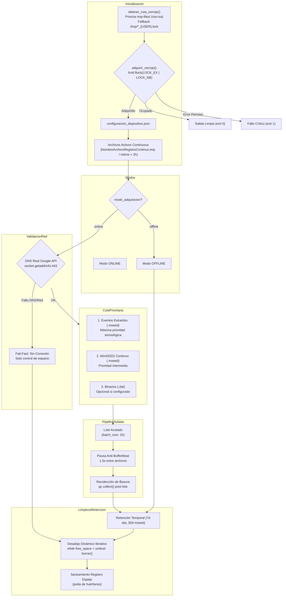

# gestor_archivos_acq.py — Contexto para Agentes IA

> Daemon/script Python robusto que gestiona el almacenamiento, sincronización con Google Drive y políticas de retención de archivos binarios (`.dat`), miniSEED continuo (`.mseed`) y eventos extraídos (`.mseed`). Incorpora cerrojo atómico exclusivo con resolución de ruta protegida (`tmp-files/`), discriminación de permisos en `fcntl.flock`, verificación DNS real contra `www.googleapis.com`, subida priorizada por lotes (`batch_size`), pausas anti-bufferbloat, desalojo dinámico iterativo con reevaluación de umbrales y recolección forzada de basura para evitar saturación de RAM, deadlocks de permisos y llenado de disco en Raspberry Pi 3B+.

**Ruta**: `scripts/operation/drive/gestor_archivos_acq.py`  
**LOC**: ~1080 | **Lenguaje**: Python 3 | **Ejecución**: Periódica (cron horaria mediante `scripts/task/registrocontinuo.sh` start)  
**Lockfile**: `$PROJECT_LOCAL_ROOT/tmp-files/gestor_archivos_acq.lock` (fallback a `/tmp/gestor_archivos_acq_${USER}.lock`)  

---

## Arquitectura y Flujo de Control



---

## Modos de Operación

### 1. Modo ONLINE (con conexión confirmada)

1. **Resolución y Adquisición de Cerrojo**:
   - `obtener_ruta_cerrojo()` determina la ubicación del lockfile priorizando `$PROJECT_LOCAL_ROOT/tmp-files/gestor_archivos_acq.lock` (propiedad de `rsa:rsa`), evitando conflictos de permisos si el archivo en `/tmp/` fue creado previamente por `root`.
   - `adquirir_cerrojo()` discrimina `BlockingIOError` (concurrencia legítima $\to$ log informativo y salida limpia código 0) de `PermissionError` (emite error a `sys.stderr` y finaliza con código 1).
2. **Detección de Archivos Activos**:
   - `obtener_archivos_activos_continuous()` inspecciona `NombreArchivoRegistroContinuo.tmp` y archivos con `mtime < 2h`.
   - Se utiliza exclusivamente `archivos_activos_continuous` para todas las evaluaciones (eliminando la variable no declarada `archivo_mas_reciente_continuous`).
3. **Verificación DNS Real**:
   - Ejecuta `socket.getaddrinfo("www.googleapis.com", 443, timeout=5)`.
4. **Subida Priorizada por Lotes (`batch_size`)**:
   - `event` $\to$ `mseed` $\to$ `continuous` (lotes de 20).
   - Pausa de 1.5s anti-bufferbloat.
   - Fail-fast ante corte de enlace.
   - `gc.collect()` tras cada lote.
5. **Políticas de Retención Temporal**:
   - `continuous > 7 días` (estandarizado en template online).
   - `mseed > 30 días` y `event > 30 días`.
6. **Desalojo Dinámico Iterativo de Espacio**:
   - En umbral mínimo (10%) y crítico (5%), ejecuta un bucle iterativo que reevalúa `get_free_space_percentage()` tras cada eliminación. Se detiene tan pronto como `free_space >= umbral_minimo`.
   - Todo el bloque de control de espacio se protege con `try...except Exception as e:` con log estructurado (`logger.error`), garantizando que un fallo de I/O en un archivo aislado no impida la ejecución del saneamiento de registros.
7. **Saneamiento del Registro Espejo**:
   - `limpiar_archivos_inexistentes()` purga huérfanos de `uploaded_files_registry.json`.
8. **Liberación Garantizada**:
   - En bloque `finally:` de `main()`.

### 2. Modo ONLINE (sin conexión o falla DNS)
- Omite llamadas a Google Drive API y retención temporal.
- Ejecuta de inmediato el control de espacio en disco de emergencia (desalojo iterativo) protegiendo archivos activos.

### 3. Modo OFFLINE
- Retención local según días configurados (`continuous: 7`, `event: 30`).
- Desalojo dinámico iterativo por umbral mínimo y crítico respetando archivos activos.

---

## Mecanismos Clave Anti-Livelock y Protección de Recursos

| Mecanismo | Implementación | Propósito / Beneficio |
|-----------|----------------|-----------------------|
| **Ruta de Cerrojo Aislada** | `obtener_ruta_cerrojo()` | Prioriza `$PROJECT_LOCAL_ROOT/tmp-files/`, inmune a colisiones de permisos con `root` en `/tmp/`. |
| **Discriminación de Excepciones Flock** | `BlockingIOError` vs `PermissionError` | Distingue concurrencia real de fallos de permisos en disco, eliminando deadlocks operativos. |
| **Desalojo Dinámico Iterativo** | `while free_space < umbral: borrar(); break si OK` | Recupera el margen de seguridad ($\ge 10\%$) en un solo ciclo horario sin acumulaciones crónicas. |
| **Envoltura Protectora de Control de Espacio** | `try...except Exception as e:` | Previene abortos prematuros y asegura siempre el saneamiento del registro JSON. |
| **Verificación DNS Real** | `socket.getaddrinfo("www.googleapis.com", 443)` | Evita falsos positivos de red cuando el gateway responde a IP pero DNS o WAN fallan. |
| **Colas Prioritarias Desacopladas** | `event` (P1) → `mseed` (P2) → `continuous` (P3) | Sube prioritariamente datos sismológicos críticos antes que el flujo continuo masivo. |
| **Procesamiento Acotado por Lotes** | `drive.config.batch_size` (default: 20) | Previene saturación de RAM por escaneo y carga de listas masivas de miles de archivos. |
| **Pausa Anti-Bufferbloat** | `time.sleep(1.5)` | Evita saturar colas de subida de routers/módems celulares 3G/4G. |
| **Recolección Forzada de Basura** | `gc.collect()` tras lotes de subida | Libera inmediatamente memoria acumulada por deserialización SSL de Google Client API. |
| **Protección de Binario Activo** | `obtener_archivos_activos_continuous()` | Previene borrado o subida del archivo en escritura activa por `registro_continuo_4.5.0.c`. |

---

## Funciones Principales

| Función | Descripción |
|---------|-------------|
| `obtener_ruta_cerrojo()` | Resuelve la ruta del lockfile priorizando `$PROJECT_LOCAL_ROOT/tmp-files/` y recurriendo a `/tmp/gestor_archivos_acq_${USER}.lock`. |
| `adquirir_cerrojo(lock_path=None, return_status=False)` | Adquiere candado exclusivo no bloqueante vía `fcntl.flock`. Discrimina `BlockingIOError` de `PermissionError`. |
| `liberar_cerrojo(lock_fd)` | Desbloquea (`LOCK_UN`) y cierra el descriptor de archivo de forma segura. |
| `obtener_archivos_activos_continuous(directorio, base_path)` | Retorna conjunto de nombres de archivos `.dat` activos (por archivo temporal del daemon C o mtime < 2h). |
| `check_internet_connection(logger)` | Resuelve `www.googleapis.com:443` con timeout de 5 segundos. |
| `subir_lote_prioritario(service, lista_archivos, ...)` | Itera archivos hasta `batch_size`, pausando 1.5s entre subidas e interrumpiendo en caso de error. |
| `eliminar_archivo_con_verificacion(...)` | Verifica si el archivo está protegido o activo antes de invocar `os.remove()`. |
| `limpiar_archivos_inexistentes(log_dir, dirs, logger)` | Sanea `uploaded_files_registry.json` eliminando claves huérfanas que ya no están en disco. |
| `_ejecutar_gestor(args)` | Núcleo de ejecución del gestor desacoplado para gestión estricta del ciclo de vida del cerrojo. |
| `main()` | Punto de entrada con control de argumentos CLI, adquisición de lock, manejo de códigos de salida (0 vs 1) y liberación en `finally`. |

---

## Configuración (`configuracion_dispositivo.json`)

Fragmento de configuración relevante:

```json
{
  "gestion_almacenamiento": {
    "umbrales": {
      "minimo": 10,
      "critico": 5
    },
    "politicas": {
      "online": {
        "subir": ["mseed", "event"],
        "retener_dias": {
          "continuous": 7,
          "mseed": 30,
          "event": 30
        }
      },
      "offline": {
        "subir": [],
        "retener_dias": {
          "continuous": 7,
          "event": 30
        }
      }
    }
  },
  "drive": {
    "carpetas": {
      "continuos_id": "DRIVE_FOLDER_CONTINUOUS_ID",
      "mseed_id": "DRIVE_FOLDER_MSEED_ID",
      "events_id": "DRIVE_FOLDER_EVENTS_ID"
    },
    "config": {
      "max_reintentos": 3,
      "tiempo_espera": 2,
      "batch_size": 20
    }
  }
}
```

---

## Interfaz de Línea de Comandos (CLI)

```bash
# Ejecución periódica estándar
python3 gestor_archivos_acq.py

# Simulación completa (dry-run: sin subidas a Drive ni borrado en disco/JSON)
python3 gestor_archivos_acq.py --dry-run

# Depuración directa del registro espejo de subidas
python3 gestor_archivos_acq.py --purge-registry

# Autenticación remota OAuth2 headless (sin navegador gráfico local)
python3 gestor_archivos_acq.py --noauth_local_webserver
```

---

## Limitaciones Conocidas

- La eliminación física de archivos es destructiva (sin papelera de reciclaje local).
- Las subidas son estrictamente secuenciales por diseño para proteger el ancho de banda y la memoria de la Raspberry Pi 3B+.
- Si Google Drive rechaza credenciales o vence el token sin renovación, el script marca fallo y no borra archivos locales protegidos.
