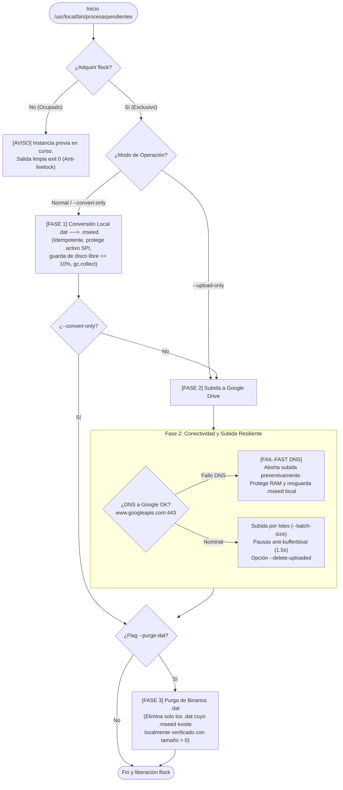

# procesar_y_subir_pendientes.py — Contexto para Agentes IA

> Herramienta desacoplada, secuencial e idempotente para conversión local (.dat a .mseed), subida resiliente a Google Drive, control de flujo por cupo dinámico y políticas de liberación de almacenamiento (--delete-uploaded, --purge-dat) en acelerógrafos RSA.

**Ruta**: `scripts/operation/drive/procesar_y_subir_pendientes.py` (ejecutable mediante wrapper `/usr/local/bin/procesarpendientes`)  
**LOC**: ~830 | **Lenguaje**: Python 3.9+ | **Dependencias**: `obspy`, `google-api-python-client`, `google-auth`, `fcntl`, `socket`, `shutil`  
**Proceso**: Invocado bajo demanda vía SSH, por crontab horario desatendido o remotamente por MQTT. Opera bajo cerrojo atómico no bloqueante `fcntl.flock` en `/tmp/procesar_y_subir_pendientes.lock`.

---

## 🏛️ Arquitectura y Flujo de Ejecución

El script está diseñado bajo el principio de **Defensa en Profundidad** y desacoplamiento para resolver contingencias operativas (como caídas prolongadas de DNS corporativo, operación 100% offline o acumulaciones masivas de binarios) sin saturar la memoria RAM ni provocar desborde de almacenamiento en disco:



---

## ⚙️ Configuraciones y Variables de Entorno

- **`PROJECT_LOCAL_ROOT`**: Ruta base del proyecto en la Raspberry Pi (por defecto `/home/rsa/projects/acelerografo`).
- **`LOCK_FILE_PATH`**: Archivo de cerrojo exclusivo `/tmp/procesar_y_subir_pendientes.lock`.
- **`configuracion_dispositivo.json`**:
  - `drive.carpetas.mseed_id`: ID de carpeta en Google Drive para registros continuos.
  - `drive.carpetas.events_id`: ID de carpeta en Google Drive para eventos sísmicos disparados.
  - `directorios.registro_continuo`: Ruta local de archivos `.dat` (`/home/rsa/data/registro-continuo/`).
  - `directorios.archivos_mseed`: Ruta local de archivos `.mseed` (`/home/rsa/data/mseed/`).
  - `directorios.eventos_extraidos`: Ruta local de eventos extraídos (`/home/rsa/data/eventos-extraidos/`).
- **`configuracion_mseed.json`**: Configuración de cabeceras miniSEED, código de estación (`CODIGO(1)`) y formato temporal de archivo.
- **`uploaded_files_registry.json`**: Registro JSON de archivos confirmados en Google Drive para trazabilidad e idempotencia en la nube.

---

## 🧩 Componentes y Funciones Clave

| Elemento / Función | Responsabilidad Técnica |
|---|---|
| `adquirir_cerrojo()` / `liberar_cerrojo()` | Gestiona el bloqueo atómico no bloqueante mediante `fcntl.flock(lock_fd, fcntl.LOCK_EX \| fcntl.LOCK_NB)`. Si otra instancia corre, aborta instantáneamente (`exit 0`), erradicando duplicación de procesos en crontab. |
| `verificar_espacio_libre(...)` | Guarda preventiva: comprueba espacio porcentual ($\ge 10\%$ o $\ge 5\%$ con purga) y megabytes libres ($\ge 500$ MB o $\ge 250$ MB con purga), abortando antes de saturar el disco para proteger la adquisición SPI. |
| `verificar_dns_drive(host, port, timeout)` | Comprueba resolución DNS real (`socket.getaddrinfo`) hacia `www.googleapis.com:443` con timeout de 5s. Evita falsos positivos de conectividad IP pura sin DNS. |
| `obtener_archivos_activos(local_root, path_rc)` | Identifica el archivo `.dat` en grabación activa continua (inspeccionando `NombreArchivoRegistroContinuo.tmp` y mtime reciente) para salvaguardarlo incondicionalmente de conversiones o purgas. |
| `convertir_archivos_pendientes(...)` | **Fase 1**: Convierte secuencialmente archivos `.dat` a `.mseed` invocando `binary_to_mseed.py`. 100% idempotente (omite si el `.mseed` ya existe), respeta el cupo estricto `max_convertir` con `gc.collect()` tras cada conversión y soporta purga inmediata de binarios convertidos. |
| `subir_archivos_pendientes(...)` | **Fase 2**: Autenticación OAuth2 y subida dosificada por lotes (`--batch-size`) con pausas anti-bufferbloat (1.5s), fail-fast si se cae la red a mitad de lote y soporte para `--delete-uploaded`. |
| `purgar_binarios_respaldados(...)` | **Fase 3**: Escanea archivos `.dat` y elimina físicamente aquellos cuyo `.mseed` equivalente ya existe localmente verificado con tamaño $> 0$. Protege el archivo activo. |
| `main()` | CLI con banderas actualizadas `--convert-only`, `--upload-only`, `--dry-run`, `--batch-size`, `--all`, `--delete-uploaded`, `--purge-dat`, `--verbosity` (con alias de retrocompatibilidad `--solo-convertir` y `--solo-subir`). |

---

## 🕹️ Parámetros por Línea de Comandos (CLI)

```bash
# Ejecución estándar (conversión y subida con cupo dinámico de 20 por defecto):
procesarpendientes

# Contingencia offline: convertir todos los .dat acumulados y liberar disco:
procesarpendientes --convert-only --all --purge-dat

# Contingencia offline por lotes dosificados:
procesarpendientes --convert-only --batch-size 50 --purge-dat

# Solo subida de archivos ya convertidos en disco:
procesarpendientes --upload-only --batch-size 20

# Simulación completa sin alterar archivos en disco ni subir a Drive:
procesarpendientes --convert-only --all --purge-dat --dry-run
```

---

## ⚠️ Limitaciones Conocidas y Buenas Prácticas

1. **Cuello de Botella en Archivos con Gaps**: La función `obtenerTraza` de `binary_to_mseed.py` (de la cual depende este módulo) presenta un cuello de botella algorítmico al rellenar segundos faltantes con `np.insert()`. Si un archivo `.dat` contiene huecos temporales, el hilo puede demorar minutos u horas. Como mitigación temporal, aislar archivos afectados en cuarentena hasta aplicar la refactorización vectorizada (ver diagnóstico técnico del 2026-10-22).
2. **Dependencia de CPU ARM**: La conversión miniSEED en Raspberry Pi toma ~0.4 a 1.0 segundos por archivo horario continuo normal. En crontab se recomienda dosificar en lotes de 20 a 30 archivos (`--batch-size 30`) para no sobrecargar el SoC.
3. **Desfase en Crontab**: Se recomienda programar en el minuto 05 de cada hora (`5 * * * *`) para evitar colisiones de E/S en el segundo exacto `00:00` en que el proceso C rota el archivo continuo.
