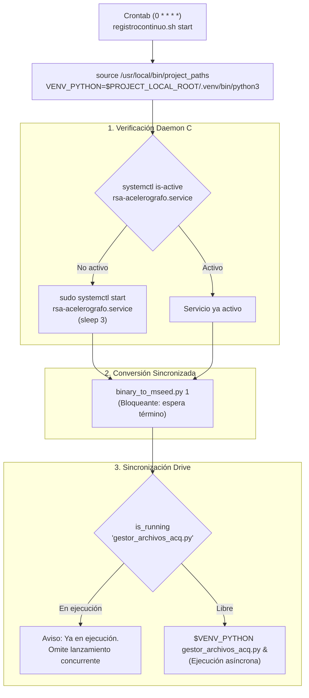

# registrocontinuo.sh — Contexto para Agentes IA

> Script Bash orquestador del pipeline de adquisición sísmica continua en Raspberry Pi. Ejecutado típicamente cada hora por crontab (`0 * * * *`). Supervisa el servicio de adquisición en C vía systemd, ejecuta secuencialmente la conversión de binarios a miniSEED y dispara el gestor de subida a Google Drive con guardas de concurrencia contra procesos colgados.

**Ruta**: `scripts/task/registrocontinuo.sh`  
**LOC**: 62 | **Lenguaje**: Bash  
**Ejecución**: Cron horaria (`crontab -e`: `0 * * * * /bin/bash .../scripts/task/registrocontinuo.sh start`) y comandos manuales de mantenimiento.

---

## Arquitectura del Orquestador



---

## Comandos y Opciones de Uso

El script acepta tres acciones principales por línea de comandos:

```bash
# Iniciar pipeline (verificar daemon, convertir miniSEED y lanzar gestor)
/ruta/scripts/task/registrocontinuo.sh start

# Detener adquisición, matar conversiones/gestores residuales y reiniciar dsPIC
/ruta/scripts/task/registrocontinuo.sh stop

# Reiniciar ciclo completo
/ruta/scripts/task/registrocontinuo.sh restart
```

---

## Flujo Detallado de Operaciones

### `start`
1. **Verificación de Adquisición SPI**: Inspecciona el estado del servicio systemd `rsa-acelerografo.service`. Si está caído, lo inicia con `sudo systemctl start rsa-acelerografo.service` y espera 3 segundos.
2. **Conversión a miniSEED (Bloqueante)**: Invoca `$VENV_PYTHON $PROJECT_LOCAL_ROOT/scripts/mseed/binary_to_mseed.py 1` de manera síncrona. Espera que la última hora de datos binarios `.dat` sea convertida a `.mseed` antes de proceder.
3. **Guarda de Concurrencia para `gestor_archivos_acq.py`**:
   - Evalúa `is_running "gestor_archivos_acq.py"` mediante `pgrep -f`.
   - Si una instancia anterior sigue en ejecución (por subida lenta o latencia en Drive), emite un mensaje y **no lanza un nuevo proceso en background**.
   - Si no está corriendo, dispara `$VENV_PYTHON $PROJECT_LOCAL_ROOT/scripts/drive/gestor_archivos_acq.py &` en segundo plano.

### `stop`
1. Detiene el servicio systemd (`sudo systemctl stop rsa-acelerografo.service`).
2. Termina procesos huérfanos con `pkill -f binary_to_mseed.py` y `pkill -f gestor_archivos_acq.py`.
3. Ejecuta el reseteo por hardware del microcontrolador dsPIC mediante el binario `reset_master` (pulsando el pin MCLR).

### `restart`
Ejecuta `$0 stop && $0 start`.

---

## Componentes y Funciones Clave

| Elemento | Tipo | Descripción |
|----------|------|-------------|
| `is_running()` | Función Bash | Ejecuta `pgrep -f "$1"` y retorna el código de salida para verificar procesos activos. |
| `VENV_PYTHON` | Variable | Apunta a `$PROJECT_LOCAL_ROOT/.venv/bin/python3`, garantizando dependencias aisladas. |
| `rsa-acelerografo.service` | Unidad Systemd | Administra el ejecutable binario C `registro_continuo_4.5.0` con reinicio automático. |
| `reset_master` | Binario C | Reinicia el hardware del dsPIC33EP mediante manipulación directa de GPIO (pin 28 wiringPi). |

---

## Limitaciones Conocidas

- Requiere privilegios `sudo` para `systemctl` y `reset_master` (configurados en `/etc/sudoers.d/`).
- La llamada a `binary_to_mseed.py 1` es síncrona; si un archivo `.dat` es masivo o está corrupto, podría demorar la ejecución de la fase de subida a Drive.
- Si `gestor_archivos_acq.py` se omite por estar corriendo, el backlog de subida se gestionará en el siguiente ciclo horario.
