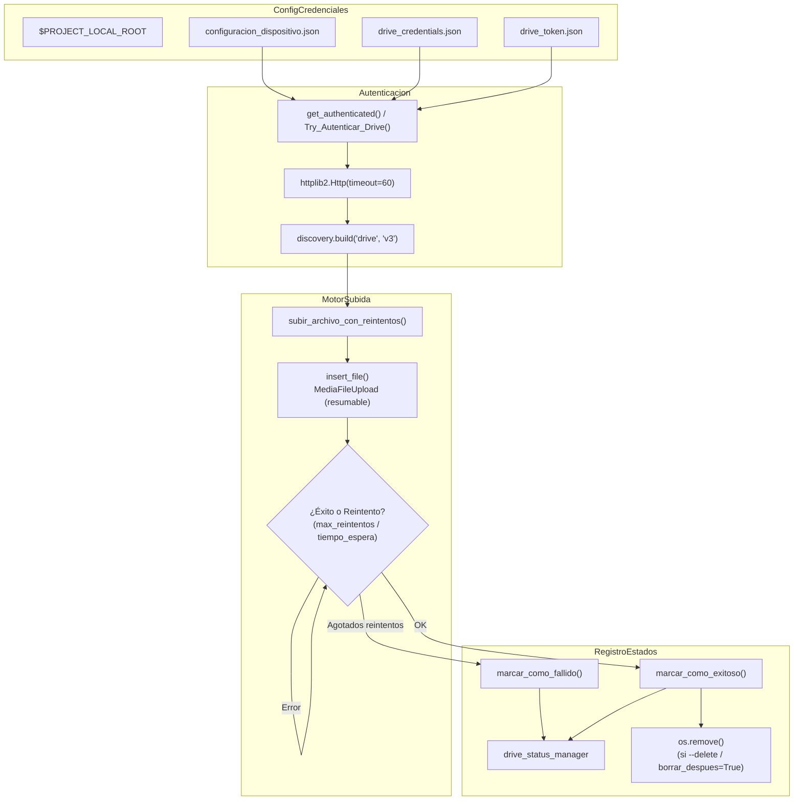

# subir_archivo.py — Contexto para Agentes IA

> Motor modular y cliente CLI de subida de archivos a Google Drive API v3. Proporciona autenticación OAuth2 headless, reintentos exponenciales configurables, registro persistente de estados (éxito/fallo) mediante `drive_status_manager`, y protección contra sockets colgados mediante timeout HTTP estricto de 60 segundos.

**Ruta**: `scripts/operation/drive/subir_archivo.py`  
**LOC**: ~510 | **Lenguaje**: Python 3 | **Dependencias**: `google-api-python-client`, `oauth2client`, `httplib2`, `drive_status_manager`  
**Proceso**: Utilidad de línea de comandos y librería importada por `gestor_archivos_acq.py` y `procesar_y_subir_pendientes.py`.

---

## Arquitectura

---

## Funcionalidades Clave

### 1. Timeout de Red Estricto (Protección Anti-Socket Hang)
- La sesión HTTP subyacente de `googleapiclient` se inicializa con `httplib2.Http(timeout=60)` en `get_authenticated()`.
- **Impacto**: En conexiones celulares o enlaces WAN inestables donde los paquetes se pierden silenciosamente (silent socket drops), previene que los sockets queden colgados indefinidamente consumiendo descriptores y bloqueando los procesos de subida.

### 2. Sistema de Reintentos Configurable
- Si la subida o la llamada a la API falla (por micro-cortes, error HTTP 5xx o desconexión), el script reintenta hasta `drive.config.max_reintentos` veces (default: 3 a 5).
- Entre cada reintento aplica una espera configurable `drive.config.tiempo_espera` (default: 2 segundos).

### 3. Integración con `drive_status_manager`
- Al completar una subida exitosa, invoca `marcar_como_exitoso()` registrando el nombre del archivo, tipo, timestamp, ID de Drive y tamaño en bytes en `uploaded_files_registry.json`. Si el archivo estaba previamente catalogado como fallido, es removido de la lista de fallos.
- Si se agotan los reintentos sin éxito, invoca `marcar_como_fallido()`. Esto protege el archivo local impidiendo que sea eliminado por las políticas de retención de espacio hasta que sea transferido con éxito.

### 4. Modo de Prueba / Simulación de Fallos (`--test`)
- Incorpora una bandera interna `TEST_MODE` activable por CLI (`--test`) que simula desconexiones o fallos de red con un 90% de probabilidad (`TEST_FAILURE_PROBABILITY = 0.9`). Permite verificar la lógica de reintentos y el marcado en `uploaded_files_registry.json` sin alterar el entorno productivo de Drive.

---

## Componentes y Funciones Principales

| Función | Parámetros Clave | Descripción |
|---------|------------------|-------------|
| `subir_archivo_con_reintentos(...)` | `service, nombre_archivo, path_completo_archivo, drive_id, max_reintentos, tiempo_espera, logger, borrar_despues, tipo_archivo, log_directory` | Bucle de subida con reintentos, manejo de excepciones, actualización de status manager y borrado opcional post-subida. |
| `get_authenticated(...)` | `SCOPES, credential_file, token_file, service_name, api_version` | Autenticación OAuth2 usando credenciales y token local. Configura `Http(timeout=60)` y construye el cliente v3 de Google Drive. |
| `insert_file(...)` | `service, name, description, parent_id, mime_type, filename` | Realiza la llamada `service.files().create()` con `MediaFileUpload(resumable=True)`. Devuelve el objeto del archivo creado en Drive. |
| `Try_Autenticar_Drive(...)` | `SCOPES, credentials_file, token_file, logger` | Wrapper de conveniencia para scripts externos; captura excepciones y retorna el servicio o `0` si falla. |
| `obtener_logger(...)` | `id_estacion, log_directory, log_filename` | Configura y almacena en caché loggers independientes por estación/contexto. |
| `read_fileJSON(nameFile)` | `nameFile` | Lectura segura y decodificación de archivos JSON de configuración. |
| `main()` | CLI args | Parser de opciones de línea de comandos, resolución de carpetas según tipo de archivo y ejecución de subida única. |

---

## Modos y Mapeo de Archivos (CLI)

El CLI mapea banderas a carpetas locales y destinos en Google Drive:

| Modo CLI | Tipo Archivo | Directorio Origen (`configuracion_dispositivo.json`) | Carpeta Destino Drive |
|----------|--------------|------------------------------------------------------|-----------------------|
| `--continuous <archivo>` | `continuous` | `directorios.registro_continuo` (`.dat`) | `drive.carpetas.continuos_id` |
| `--mseed <archivo>` | `mseed` | `directorios.archivos_mseed` (`.mseed`) | `drive.carpetas.mseed_id` |
| `--event <archivo>` | `event` | `directorios.eventos_extraidos` (`.mseed` / `.dat`) | `drive.carpetas.events_id` |
| `--tmp <archivo>` | `tmp` | `directorios.archivos_temporales` (`.tmp`) | `drive.carpetas.tmp_id` |
| `--log <archivo>` | `log` | `$PROJECT_LOCAL_ROOT/log-files/` | `drive.carpetas.logs_id` |

### Parámetros Opcionales de CLI
- `--delete`: Elimina el archivo local tras confirmación de subida exitosa.
- `--noauth_local_webserver`: Permite autenticar en entornos remotos vía SSH sin navegador web gráfico.
- `--test`: Activa simulación de fallos de red al 90% para verificación de robustez.

---

## Limitaciones Conocidas

- No implementa paralelismo ni subidas en chunks múltiples (subida resumable de flujo único).
- Las credenciales deben estar pre-generadas en `drive_credentials.json` y `drive_token.json`.
- En caso de token revocado o corrupto, requiere re-autenticación interactiva usando `--noauth_local_webserver`.
