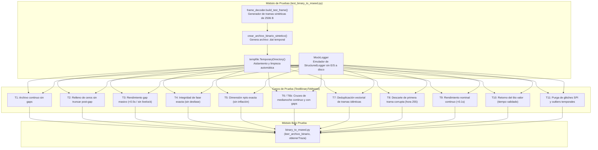

# test_binary_to_mseed.py — Contexto para Agentes IA

> Suite de pruebas unitarias sintéticas automatizadas para certificar la corrección sismológica, el rendimiento sin livelock ante gaps masivos, la integridad de fase y la robustez ante tramas corruptas en `binary_to_mseed.py`.

**Ruta**: `scripts/operation/mseed/test_binary_to_mseed.py`  
**LOC**: 429 | **Lenguaje**: Python 3 | **Dependencias**: `unittest`, `tempfile`, `numpy`, `obspy`, `binary_to_mseed`, `frame_decoder`  
**Proceso**: `.venv/bin/python3 scripts/mseed/test_binary_to_mseed.py` (ejecución autónoma o en CI/pytest)  

---

## Arquitectura



---

## Catálogo de Pruebas Unitarias

| Test | Método | Objetivo Sismológico / Técnico | Criterio de Éxito |
|---|---|---|---|
| **T1** | `test_conversion_sin_gaps` | Valida conversión nominal de archivo sin pérdidas. | `gaps is None`, $10 \times 250 = 2500$ muestras. |
| **T2** | `test_conversion_con_gap_corto` | Comprueba que gaps intermedios no corten los datos posteriores. | Segundos posteriores al gap conservan su amplitud ($1000$). |
| **T3** | `test_conversion_gap_masivo_rendimiento` | Simula archivo de CHA02 con $3500$s de ceros (antiguo livelock). | Ejecución $< 0.5$ s en CPU, $900{,}000$ muestras exactas. |
| **T4** | `test_integridad_fase_sin_desfase` | Asegura que cada bloque de 250 muestras coincida con su segundo exacto. | Muestras del segundo $5$ quedan exactamente en $[1250:1500]$. |
| **T5** | `test_dimension_exacta_sin_inflacion` | Verifica que `npts` no sume doblemente los gaps. | `len(traza.data) == stats.npts == (tramas + gaps) * 250`. |
| **T6** | `test_cruce_medianoche` | Verifica continuidad en salto $23:59:59 \to 00:00:00$. | `gaps is None`, no se crean gaps falsos de medianoche. |
| **T6b**| `test_cruce_medianoche_con_gap` | Detecta gaps reales a través de medianoche ($23:59:58 \to 00:00:02$). | Lista de gaps detecta exactamente $[86399, 0, 1]$. |
| **T7** | `test_tramas_duplicadas_filtradas` | Tramas repetidas con mismo timestamp se deduplican en $O(1)$. | Preserva primera ocurrencia, dimensiona $3 \times 250$ muestras. |
| **T8** | `test_primera_trama_invalida_timestamp_validado` | Si la primera trama física tiene hora=255, se descarta y sincroniza con la segunda. | `t_valid['segundo'] == 1`, descarta trama 0 sin error. |
| **T9** | `test_archivo_sin_gaps_rendimiento` | Mide tiempo de conversión en traza nominal completa de 1 hora. | Tiempo $< 0.1$ s, $900{,}000$ muestras. |
| **T10**| `test_retorno_sexto_valor_tiempo_validado` | Comprueba que `leer_archivo_binario` entregue 6 valores estructurados. | Retorna tupla de longitud 6, `res[5]` es `dict`. |
| **T11**| `test_purga_glitch_spi_y_outlier_temporal_t11` | Inyecta glitch SPI (`0x04 0x04 0x04`) y outlier aislado diurno (`04:04:04` a las 17h). | Ambas tramas son purgadas; la traza dura 6s exactos y no 25 horas. |

---

## Componentes Auxiliares y Fixtures

### 1. `MockLogger`
Implementación ligera compatible con los métodos semánticos de `StructuredLogger` (`data_warning`, `convert_fail`, `convert_ok`, `read_ok`, `convert_start`, `info`, `error`, `summary`). Evita la creación de archivos de log temporales o interferencia de E/S durante los tests.

### 2. `crear_archivo_binario_sintetico(tramas_specs, filepath)`
Construye archivos `.dat` temporales bit a bit mediante `frame_decoder.build_test_frame()`. Permite especificar segundo a segundo:
* Timestamps arbitrarios (`year`, `month`, `day`, `hour`, `minute`, `second`).
* Valores simulados de aceleración por canal (`x_value`, `y_value`, `z_value`).
* Corrupción de bytes específicos para pruebas de tolerancia a fallos.

---

## Ejecución y Checkpoints

```bash
# Ejecutar en el entorno virtual del acelerógrafo:
cd /home/rsa/projects/acelerografo
.venv/bin/python3 scripts/mseed/test_binary_to_mseed.py

# Resultado esperado:
# Ran 12 tests in 0.096s - OK
```

---

## Dependencias y Prerrequisitos

* `core/frame_decoder.py`: Reutiliza la función `build_test_frame` para emular tramas acelerográficas exactas de 2506 bytes.
* `mseed/binary_to_mseed.py`: Funciones bajo prueba (`leer_archivo_binario`, `obtenerTraza`, `conversion_mseed_digital`).
