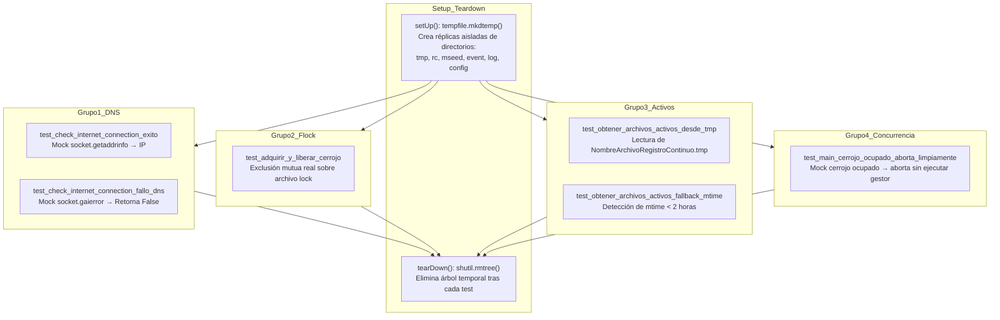

# test_gestor_archivos_acq.py — Contexto para Agentes IA

> Suite de pruebas unitarias basadas en `unittest` para verificar el blindaje del gestor de archivos de adquisición (`gestor_archivos_acq.py`). Valida resolución DNS real sin falsos positivos, exclusión mutua de procesos mediante cerrojo `fcntl.flock`, detección y protección de archivos binarios activos y aborto limpio en concurrencia.

**Ruta**: `scripts/operation/drive/test_gestor_archivos_acq.py`  
**LOC**: 119 | **Lenguaje**: Python 3 | **Dependencias**: `unittest`, `unittest.mock`, `tempfile`, `shutil`, `socket`, `fcntl`, `gestor_archivos_acq`  
**Proceso**: Ejecución local en entornos de desarrollo (DEV0 / DEV00):  
`$PROJECT_LOCAL_ROOT/.venv/bin/python3 scripts/drive/test_gestor_archivos_acq.py`

---

## Arquitectura de Pruebas

La suite aísla completamente las operaciones sobre el sistema de archivos productivo utilizando directorios temporales generados por `tempfile.mkdtemp(prefix="test_gestor_dev0_")` con limpieza estricta en `tearDown()`.



---

## Cobertura de la Suite de Pruebas (6 Tests)

| Caso de Prueba | Método / Escenario Validado | Mecanismo de Verificación |
|----------------|-----------------------------|---------------------------|
| `test_check_internet_connection_exito` | Resolución DNS exitosa a `www.googleapis.com` | `patch("socket.getaddrinfo")` retorna tupla de conexión exitosa → verifica que la función retorna `True`. |
| `test_check_internet_connection_fallo_dns` | Falso positivo de red evitado cuando DNS falla | Simula `socket.gaierror(-3)` → valida que la función retorna `False` sin intentar subidas ciegas. |
| `test_adquirir_y_liberar_cerrojo` | Exclusión mutua atómica con `fcntl.flock` | Abre dos cerrojos concurrentes sobre el mismo archivo en disco; el segundo debe ser `None`. Tras `liberar_cerrojo()`, un tercer intento adquiere el lock exitosamente. |
| `test_obtener_archivos_activos_desde_tmp` | Protección de archivo en escritura activa | Crea `NombreArchivoRegistroContinuo.tmp` simulando la rotación horaria de `registro_continuo_4.5.0.c`. Comprueba que la primera línea se marca como protegida y líneas viejas se descartan. |
| `test_obtener_archivos_activos_fallback_mtime` | Salvaguarda de archivos recientes si falta el `.tmp` | Valida que archivos `.dat` modificados hace menos de 2 horas se agreguen a la lista de exclusión de borrado. |
| `test_main_cerrojo_ocupado_aborta_limpiamente` | No acumulación de procesos en crontab | Simula contienda en `adquirir_cerrojo` retornando `None`. Valida que `_ejecutar_gestor` nunca sea invocado. |

---

## Ejecución y Validación

Para correr esta suite junto con la de pendientes (`test_procesar_y_subir_pendientes.py`):

```bash
# Ejecutar solo la suite del gestor
$PROJECT_LOCAL_ROOT/.venv/bin/python3 scripts/drive/test_gestor_archivos_acq.py

# Ejecutar suite combinada de pruebas de Drive (18 tests totales)
$PROJECT_LOCAL_ROOT/.venv/bin/python3 -m unittest \
  scripts/drive/test_gestor_archivos_acq.py \
  scripts/drive/test_procesar_y_subir_pendientes.py
```

---

## Limitaciones Conocidas

- La prueba de cerrojo `fcntl.flock` requiere un sistema de archivos compatible con POSIX locks (no soportado en montajes CIFS/SMB sin emulación de locks).
- Las pruebas de red no realizan llamadas HTTP reales a Google Drive para garantizar determinismo y velocidad de ejecución (< 2 segundos).
